===========
Quick start
===========

open-plan-tool runs in your web browser, so there is nothing to install to get started. This guide walks you through the five basic steps: create an account, create a project, build a scenario, run the simulation and read the results. If you want to host the tool yourself instead, see :doc:`installation`.

First steps
-----------

Create an account
^^^^^^^^^^^^^^^^^
The first step to start using open-plan-tool is to create an account. To do this, you must click on the "Sign up" button at the top right corner and fill in the following information: your name, email address, username and password. Finally, do not forget to read and accept the privacy statement. You should receive an email with a link to confirm the account creation. You can find our privacy policy `here <https://open-plan.rl-institut.de/en/privacy/>`_.

Explore the dashboard
^^^^^^^^^^^^^^^^^^^^^

When you log in, the following dashboard is displayed. In the following image the points described below are labeled with numbers and letters.

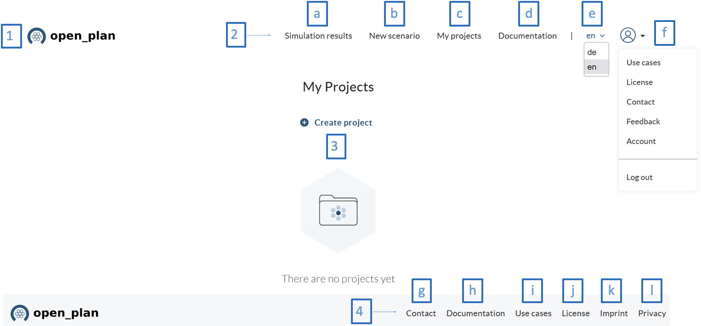

**1. Logo.** Clicking here takes you back to the home screen with your projects.

**2. Top navigation menu.** Located on the upper right part of the screen, it contains:

    a) Resources. A drop-down menu with the user manual, video tutorials, courses and workshops, the GitHub repository and the use cases.
    b) About us. A drop-down menu with an overview of the project, contact information, sponsoring and the feedback form.
    c) Language. English (en) and German (de) are supported.
    d) My projects. Takes you to the list of your projects.
    e) Profile drop-down menu. Here you find your account settings, the license information and the log out option.

**3. Dashboard.** Here you find the link to create a new project, or the list of your projects once they exist.

**4. Bottom navigation menu.** Located at the bottom right of the screen, it contains:

    f) License. The license information.
    g) Imprint. Important information about the tool and some disclaimers.
    h) Privacy. Information on data protection, data processing and the related legal and policy issues.

The version of the tool is shown next to these links.

Create a project
^^^^^^^^^^^^^^^^

To create a project in open-plan-tool, the user has three options:

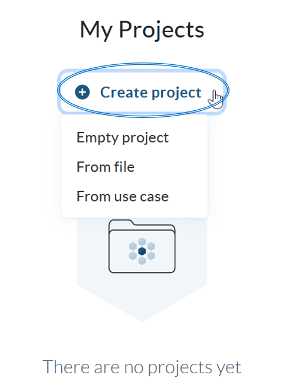

:Empty project:

Here a project is created from scratch. When you select this option you must configure your project and for that you must include the following information: 

- Name

- Description

- Country

- Location (coordinates)

- Duration (years)

- Currency

- Discount factor

:From file:

It is also possible to load a project from a file. In this case you must include the name of the project and upload the file in json format. This option makes it possible to share projects among each other.

:From use case:

If you want to start from one of the configured use cases, you can do so in this option. You will see a pop-up window with a link to the use cases, and a drop-down list where you can choose the use case to use. Once selected, it will appear in the "My projects" section.

Create a scenario
^^^^^^^^^^^^^^^^^

Once the project is created, it is possible to create various scenarios within the project. To do this, you have two options: you can create a new scenario by defining all its parameters or you can load a previously created scenario from a json file. So here there is also the option to share scenarios among each other. 

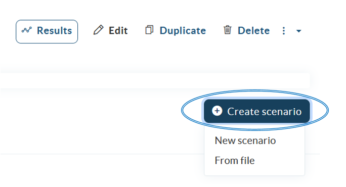

When creating a scenario from scratch, there are four steps to go through:

1) Scenario setup
2) Energy system design
3) Simulation
4) Results.

At the top you will see the name of the project (in bold type), the name of the scenario, the four steps of the scenario workflow, and a marker showing which step you are in.

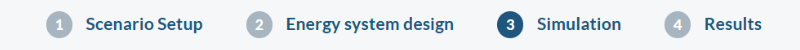

Below is a brief description of what should be done at each step.

**1) Scenario setup**

In the setup you enter:

- the name and a description of the scenario,
- the evaluated period, i.e. the number of days the simulation covers,
- the length of the time steps of the simulation in minutes,
- the start date. This date is important, because it determines which part of your time series is used and how the data is plotted,
- the fixed project costs, which include the planning and development costs of the project.

**2) Energy system design**

In this section the energy system will be designed using different components, which are located on the left panel and classified in different categories, for example **Providers, Production, Conversion, Storage, Demand, Sink, Transport and Bus.** The exact list of categories can change between versions of the tool.
In the graphic panel drag the components you need to design your energy system and do not forget to include the buses. Note that assets are connected to each other using a bus which is the identifier for the energy carrier (e.g. electricity or heat). Interconnecting two buses or two assets directly is not allowed. Connect the components together by dragging a line from the output terminal of one component to the input terminal of the next one, see the following example:

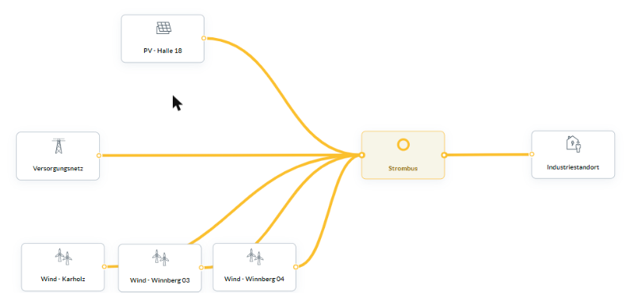

The components representing **battery energy storage systems (BESS)** have been defined with one input and one output. The BESS can be connected directly to the electrical bus; please note that the bus is supplied and feeds the battery at the same time.

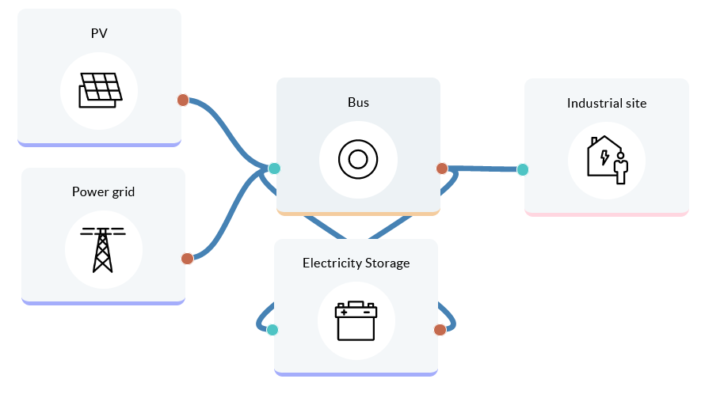

When you click on the components, a screen appears where you can configure the different parameters. The input parameters are different for each component category, however, you will typically find three ways to complete the information: spaces to enter values, drop-down lists with default information or buttons to load time series (in this case, a graph will be displayed where the loaded data series can be previewed). The input field for the components that belong to one category (e.g. the conversion components) contains usually the same parameters, but there are also components that may differ slightly, such as the heat pump. Below we show you as an example some of the component setup screens.

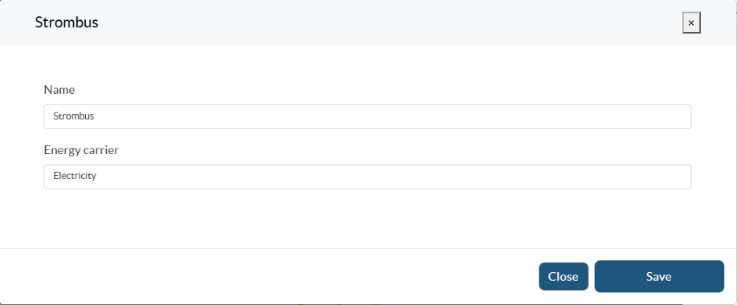

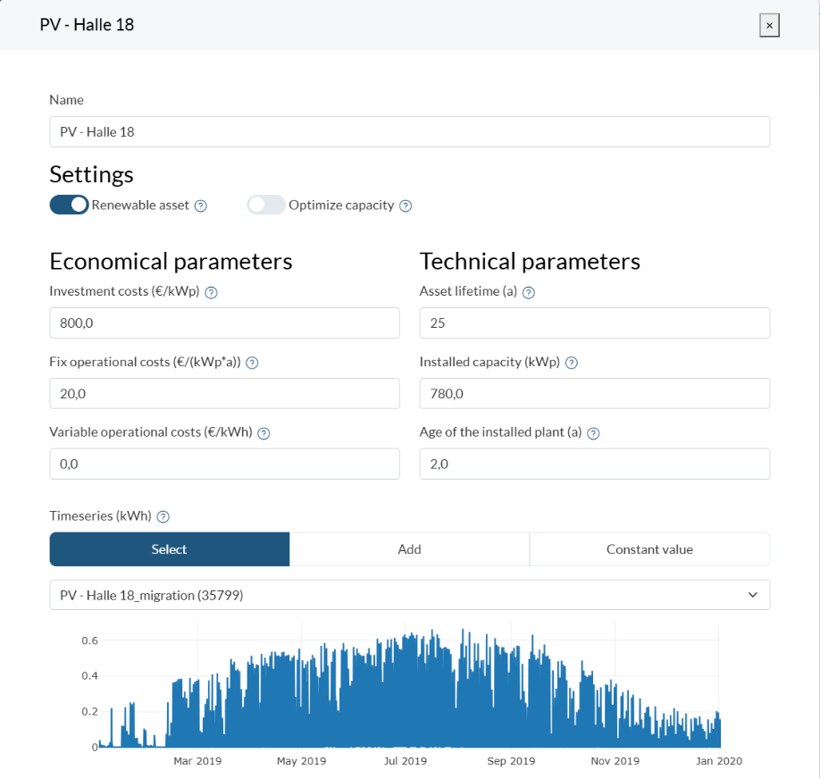

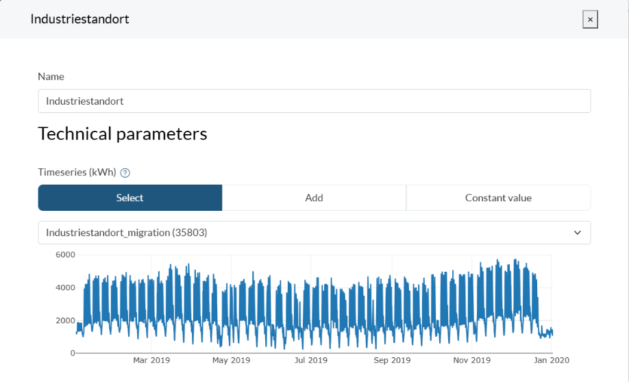

Before proceeding to the next section, be sure to complete the information requirements for each component and save the energy system.

**3) Simulation**

Once the energy system is complete, you proceed to the simulation panel. At the bottom you find the button **Run simulation**. A one-year simulation usually takes only a few minutes; the status is checked automatically every few seconds and you can cancel a running simulation.

When the message *Simulation successful* appears, click **Check results dashboard** to see the results of your scenario. With **Reset simulation** you can run it again after changing the energy system.

Further you can select the option whether you want to include an LP file. With the LP file you can look the mathematical formulation consisting of objective function and constraints. It is recommended to choose a small number of days to evaluate (e.g. one day) to keep the LP file readable. After running the simulation you can download the LP file and open it in a text editor.

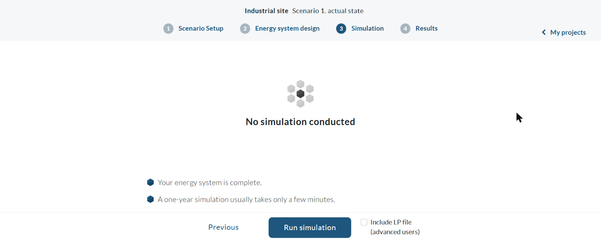

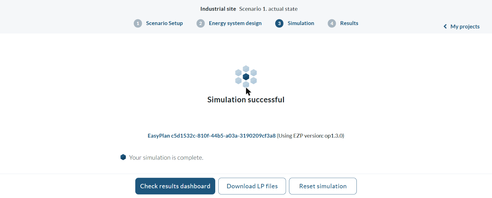

**4) Results**

The results step is the results dashboard described in the next section.

Simulation results
^^^^^^^^^^^^^^^^^^

In the **results dashboard** you can have a detailed look at the results of your scenarios. When pressing the button you are automatically in the currently simulated scenario, but you can select another project [1]. Within the views described below you can also select another scenario. Only scenarios that have already been simulated are displayed.

In the upper right part you have the possibility to download all timeseries of the scenario including given timeseries and simulation results, the resulting Key Performance Indicators (KPIs), and the component costs as Excel files [2]. Further you can return to the scenario setup [3].

To view the most relevant results directly, you have three options: **single scenarios, compare scenarios and sensitivity analysis [4].**

.. note::
   The sensitivity analysis is not fully implemented yet (see below).

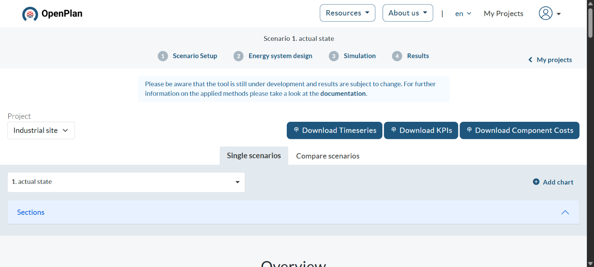

:Single scenarios:

This option makes it easy to view the results of one scenario at a time. On the left is a drop-down menu where the scenario is selected (a) and on the right is the option to add a new chart (b).

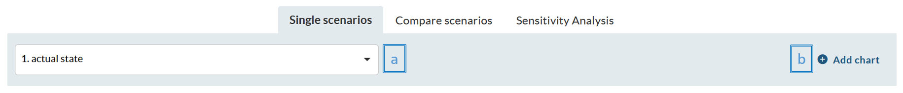

Subsequently, the scenario KPIs (key performance indicators) are presented:

- **Degree of autonomy:** A value close to 0 shows a high dependence on the energy provider, a value of 1 represents an autonomous system.
- **Levelized costs of electricity equivalent:** The levelized cost of energy of the sector-coupled energy system, calculated from the annuity of the system and the total system demand in electricity equivalent.
- **Onsite energy fraction:** Also called self-consumption. The fraction of all locally generated energy that is consumed by the system itself.
- **Renewable factor:** The share of the energy influx to the local energy system that comes from renewable sources. It includes local generation as well as the consumption from energy providers.
- **Renewable share of local generation:** The share of the locally generated energy that comes from renewable sources. It does not include the consumption from energy providers.

A detailed description of all outputs can be found in :doc:`../model/simulation_outputs`.

Then, you will be able to visualize the energy system, all its components and connections. Finally, some charts summarizing the results of the scenario are presented, including the overall cost breakdown, the energy series (in kW), the installed and optimized capacity, as well as a Sankey diagram, which shows the energy flows between the components of the system.

Additional charts can be included, as shown in the image above with item b. The charts are interactive, as you can see the value by hovering the pointer over the chart, and there is a menu that appears in the upper right corner of the chart area. Here you can zoom in and out, reset the axes, download the image as .png format, among other options. In the legend of the charts you can select which data series to view or hide with a single click. Tables and charts can be exported in .xls, .pdf format. To do so, you can locate the three dots in the upper right corner of the tables or charts, click on them and select the alternative that suits you best.

:Compare scenarios:

It is also possible to compare the results of multiple scenarios. You only need to include the scenarios to be compared (c). Remember that you can add additional charts if necessary (b).

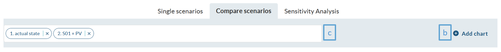

For each scenario, a column with the values will appear in the KPI table. Also, the cost, energy and installed and optimized capacity charts show the values of the scenarios. This facilitates the comparison of the data.

As for the previous option, the charts are interactive, can be adjusted according to your needs, and both the table and the charts can be exported in different formats.

:Sensitivity analysis:

This functionality is not fully implemented yet. At the moment you get an error as soon as you click the button. We are working on this feature.

Feedback or Question
--------------------

We are happy to hear about your experience with open-plan-tool, so feel free to share your questions, comments and suggestions `here. <https://open-plan.rl-institut.de/en/user_feedback>`_ We will get back to you as soon as possible.
Your question may already be answered in the :ref:`FAQ <faq>` below.
On the project's GitHub page you can keep track of the developments that are in progress or have been completed.

.. _faq:

FAQ
---

General
^^^^^^^

**What is open-plan-tool?**

An open-source web tool for designing and optimizing energy systems with several energy carriers (e.g. electricity, heat and hydrogen), for neighborhoods, industrial parks and industries. It calculates the combination of components with the lowest annual energy supply costs and is based on the multi-vector simulator (MVS).

**Do I need programming skills?**

No. The tool was developed with a strong focus on easy use, without requiring programming language expertise.

**Do I need to install anything?**

No. You can use the online tool in your browser. An installation is only needed if you want to host the tool yourself, see :doc:`installation`.

Projects and scenarios
^^^^^^^^^^^^^^^^^^^^^^

**How can I create a project?**

There are three ways: as an empty project, from a json file, or from one of the use cases. See `Create a project`_.

**Can I share projects or scenarios with others?**

Yes. Projects and scenarios can be loaded from a json file, which makes it possible to share them.

**Why can't I connect two components directly?**

Components are always connected through a bus, which stands for an energy carrier (e.g. electricity or heat). Connecting two assets or two buses directly is not allowed. Connect the components by dragging a line from the output terminal of one component to the input terminal of the next.

**How do I connect a battery?**

Battery energy storage systems (BESS) have one input and one output and can be connected directly to the electrical bus. The bus supplies the battery and is fed by it at the same time.

**What is the LP file and when should I use it?**

The LP file contains the mathematical formulation of the optimization problem (objective function and constraints). You can include it in the simulation panel and open it in a text editor after the simulation. Choose a small number of days to evaluate (e.g. one day) to keep the file readable.

Results
^^^^^^^

**How do I compare scenarios?**

Open the results dashboard and select *compare scenarios*. Add the scenarios you want to compare. Each scenario gets its own column in the KPI table and its own values in the charts.

**Can I download my results?**

Yes. In the results dashboard you can download all time series, the KPIs and the component costs as Excel files. Tables and charts can also be exported (e.g. as .xls or .pdf) using the three dots in the upper right corner.

**Why do I get an error in the sensitivity analysis?**

This functionality is not fully implemented yet. We are working on it.

**Where can I find the definition of a KPI?**

See :doc:`../model/simulation_outputs`.

Hosting
^^^^^^^

**Can I host the tool myself?**

Yes. The installation instructions are described in :doc:`installation`, and :doc:`basic_structure` explains how the parts of the tool work together.
