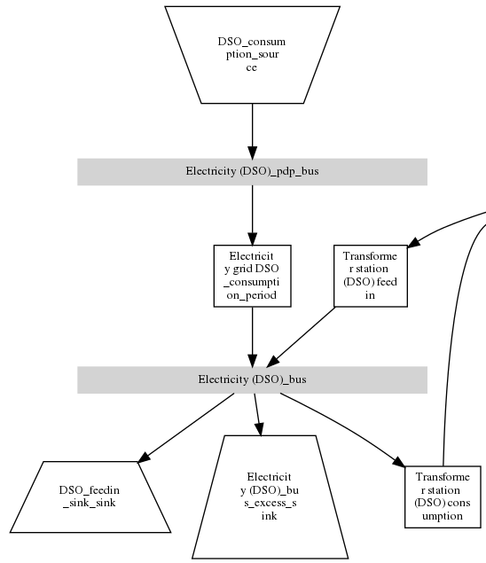

.. This page is generated automatically from parameter_list_eesyplan.csv, parameter_long_description_eesyplan.csv and component_hdrs.csv by _scripts/component_models_csv.py.
   Changes have to be made in the CSV files, not here.

.. role:: cm-source

.. role:: cm-input

.. _component_models:

Component models
----------------

The component models of the open-plan-tool are implemented in the Python library :code:`oemof-eesyplan`, which is based on the energy system modelling framework :code:`oemof-solph`.

The components are simplified and linearized. This is why the open-plan-tool is suited for a pre-feasibility study of a specific system setup, but not for the final sizing and system design. The types of components are presented below.

.. raw:: html

   

     

       <a class="cm-card-title" href="#Energy bus">Energy bus1</a>
       <ul class="cm-card-list">
         <li><a href="#comp-carrierbus">CarrierBus</a></li>
       </ul>
     

     

       <a class="cm-card-title" href="#Energy consumption">Energy consumption4</a>
       <ul class="cm-card-list">
         <li><a href="#comp-heatdemand">HeatDemand</a></li>
         <li><a href="#comp-electricitydemand">ElectricityDemand</a></li>
         <li><a href="#comp-h2demand">H2Demand</a></li>
         <li><a href="#comp-fueldemand">FuelDemand</a></li>
       </ul>
     

     

       <a class="cm-card-title" href="#Energy production">Energy production4</a>
       <ul class="cm-card-list">
         <li><a href="#comp-pvplant">PvPlant</a></li>
         <li><a href="#comp-windturbine">WindTurbine</a></li>
         <li><a href="#comp-solarthermalplant">SolarThermalPlant</a></li>
         <li><a href="#comp-geothermalplant">GeothermalPlant</a></li>
       </ul>
     

     

       <a class="cm-card-title" href="#Energy conversion">Energy conversion9</a>
       <ul class="cm-card-list">
         <li><a href="#comp-electrolyzer">Electrolyzer</a></li>
         <li><a href="#comp-chpvariableratio">ChpVariableRatio</a></li>
         <li><a href="#comp-chpfixedratio">ChpFixedRatio</a></li>
         <li><a href="#comp-fuelcell">FuelCell</a></li>
         <li><a href="#comp-fuelgenerator">FuelGenerator</a></li>
         <li><a href="#comp-electricaltransformator">ElectricalTransformator</a></li>
         <li><a href="#comp-boiler">Boiler</a></li>
         <li><a href="#comp-heatpump">HeatPump</a></li>
         <li><a href="#comp-biogasplant">BiogasPlant</a></li>
       </ul>
     

     

       <a class="cm-card-title" href="#Energy providers">Energy providers4</a>
       <ul class="cm-card-list">
         <li><a href="#comp-dsohydrogen">DsoHydrogen</a></li>
         <li><a href="#comp-dsoheat">DsoHeat</a></li>
         <li><a href="#comp-dsofuel">DsoFuel</a></li>
         <li><a href="#comp-dsoelectricity">DsoElectricity</a></li>
       </ul>
     

     

       <a class="cm-card-title" href="#Energy storage">Energy storage4</a>
       <ul class="cm-card-list">
         <li><a href="#comp-fuelstorage">FuelStorage</a></li>
         <li><a href="#comp-thermalstorage">ThermalStorage</a></li>
         <li><a href="#comp-hydrogenstorage">HydrogenStorage</a></li>
         <li><a href="#comp-electricalstorage">ElectricalStorage</a></li>
       </ul>
     

     

       <a class="cm-card-title" href="#Energy transport">Energy transport2</a>
       <ul class="cm-card-list">
         <li><a href="#comp-heatingnetwork">HeatingNetwork</a></li>
         <li><a href="#comp-heatingpipe">HeatingPipe</a></li>
       </ul>
     

   

.. _Energy bus:

Energy bus
##########

.. raw:: html

   

     <a class="cm-tile" href="#comp-carrierbus">CarrierBus</a>
   

An energy bus connects all components that exchange the same energy carrier, e.g. all electricity producers,
consumers and storages of the system. In every timestep, the energy fed into a bus has to equal the energy taken
from it. To keep this balance even if supply and demand cannot be matched exactly, every bus is complemented by two
virtual components: the Excess component absorbs surplus energy and the Shortage component covers demand that cannot
be met. Both belong to a bus and are not used on their own; their costs define how strongly the optimization avoids
surplus energy and supply gaps.

.. _comp-carrierbus:

CarrierBus
==========

.. container:: cm-head

   .. image:: ../_static/icons/CarrierBus.svg
      :alt: CarrierBus icon

   .. rst-class:: cm-default-set

   :cm-source:`Name as it will show in the results`

The Energy Bus component is used to connect all producers, consumers, storages and conversion components that exchange the same energy carrier, such as electricity, heat, gas or hydrogen. During operation, it takes the energy flows of all connected components as its input and, through an energy balance in every timestep (total incoming energy equals total outgoing energy, valid for all bus types), distributes them to the connected outputs without losses. This process is mainly governed by the balanced bus parameter, which defines whether supply and demand must be equal in every timestep, together with the excess and shortage energy costs that penalize any imbalance. Surplus and missing energy are handled by the Excess and Shortage components, which belong to the bus and are described below.

.. _comp-CarrierBus-energy_carrier:

.. rst-class:: cm-param

Energy carrier
^^^^^^^^^^^^^^

The energy carrier defines which energy carrier is transported on the bus, e.g. electricity, heat, gas or hydrogen. All components connected to the same bus exchange energy via this carrier, and the carrier is inherited by connected components when they are created. It therefore determines which components can be connected to the bus and how their energy flows are interpreted in the energy balance.

.. _Energy consumption:

Energy consumption
##################

.. raw:: html

   

     <a class="cm-tile" href="#comp-heatdemand">HeatDemand</a>
     <a class="cm-tile" href="#comp-electricitydemand">ElectricityDemand</a>
     <a class="cm-tile" href="#comp-h2demand">H2Demand</a>
     <a class="cm-tile" href="#comp-fueldemand">FuelDemand</a>
   

Demands are added as consumption components. They are mainly defined by a timeseries, which represents the demand profile, and by their energy carrier. Several demands can be defined for one energy system, both of the same and of different energy carriers.

The main goal of the optimization is to supply all demands in every timestep at the lowest cost (see :ref:`economic_precalculation-label`).

.. _comp-heatdemand:

HeatDemand
==========

.. container:: cm-head

   .. image:: ../_static/icons/HeatDemand.svg
      :alt: HeatDemand icon

   .. list-table::
      :header-rows: 1
      :class: cm-param-table

      * - Parameter
        - Default
        - Unit
      * - :ref:`Timeseries <comp-HeatDemand-timeseries>`
        - 
        - kW

   .. rst-class:: cm-default-set

   :cm-source:`The demand must be met at all times. If this is not possible within the defined energy system the simulation will show an error.`

The Heat Demand component is used to represent the thermal energy consumption for space heating, domestic hot water or process heat in both centralized and decentralized configurations. During operation, it takes heat from the connected heat bus as its primary input and, following a fixed load profile, consumes it in every timestep. This process is mainly governed by the timeseries parameter, which defines the heat load that has to be covered in each timestep.

.. _comp-HeatDemand-timeseries:

.. rst-class:: cm-param

Timeseries
^^^^^^^^^^

The timeseries describes the heat demand that has to be covered in each hour, given as average power in kW; with hourly timesteps, a value of 12,5 kW corresponds to a consumption of 12,5 kWh in that hour. The number of values must match the scenario settings, i.e. 8.760 values for 365 days with 60-minute timesteps, and the first value belongs to the start date of the simulation. The data can be uploaded as an Excel file with two columns, in which column A contains the hour number (1 to 8.760) or a timestamp and column B the values; a header row is allowed, but empty cells are not. Alternatively, a CSV file without header can be used, either with one column containing only the values or with two columns separated by a semicolon (e.g. 1;12,5). Typical data sources are measured heat consumption data or load profiles based on outdoor temperatures; the profile should include space heating and domestic hot water. As a plausibility check, the sum of all values gives the annual heat demand in kWh.

General description: :ref:`Normed Timeseries <param-timeseries>`

.. _comp-electricitydemand:

ElectricityDemand
=================

.. container:: cm-head

   .. image:: ../_static/icons/ElectricityDemand.svg
      :alt: ElectricityDemand icon

   .. list-table::
      :header-rows: 1
      :class: cm-param-table

      * - Parameter
        - Default
        - Unit
      * - :ref:`Timeseries <comp-ElectricityDemand-timeseries>`
        - 
        - kW

   .. rst-class:: cm-default-set

   :cm-source:`The demand must be met at all times. If this is not possible within the defined energy system the simulation will show an error.`

The Electricity Demand component is used to represent the electrical energy consumption of households, buildings or industrial processes in both centralized and decentralized configurations. During operation, it takes electrical energy from the connected electricity bus as its primary input and, following a fixed load profile, consumes it in every timestep. This process is mainly governed by the timeseries parameter, which defines the electrical load that has to be covered in each timestep.

.. _comp-ElectricityDemand-timeseries:

.. rst-class:: cm-param

Timeseries
^^^^^^^^^^

The timeseries describes the electricity demand that has to be covered in each hour, given as average power in kW; with hourly timesteps, a value of 12,5 kW corresponds to a consumption of 12,5 kWh in that hour. The number of values must match the scenario settings, i.e. 8.760 values for 365 days with 60-minute timesteps, and the first value belongs to the start date of the simulation. The data can be uploaded as an Excel file with two columns, in which column A contains the hour number (1 to 8.760) or a timestamp and column B the values; a header row is allowed, but empty cells are not. Alternatively, a CSV file without header can be used, either with one column containing only the values or with two columns separated by a semicolon (e.g. 1;12,5). Typical data sources are measured load data, e.g. from smart meters, or standard load profiles such as the BDEW profiles H0 (households) or G0 (commerce) scaled to the annual consumption. As a plausibility check, the sum of all values gives the annual electricity demand in kWh.

General description: :ref:`Normed Timeseries <param-timeseries>`

.. _comp-h2demand:

H2Demand
========

.. container:: cm-head

   .. image:: ../_static/icons/H2Demand.svg
      :alt: H2Demand icon

   .. list-table::
      :header-rows: 1
      :class: cm-param-table

      * - Parameter
        - Default
        - Unit
      * - :ref:`Timeseries <comp-H2Demand-timeseries>`
        - 
        - kW

   .. rst-class:: cm-default-set

   :cm-source:`The demand must be met at all times. If this is not possible within the defined energy system the simulation will show an error.`

The Hydrogen Demand component is used to represent the hydrogen consumption of industrial processes, mobility applications or other hydrogen consumers in both centralized and decentralized configurations. During operation, it takes hydrogen from the connected hydrogen bus as its primary input and, following a fixed load profile, consumes it in every timestep. This process is mainly governed by the timeseries parameter, which defines the hydrogen demand that has to be covered in each timestep.

.. _comp-H2Demand-timeseries:

.. rst-class:: cm-param

Timeseries
^^^^^^^^^^

The timeseries describes the hydrogen demand that has to be covered in each hour, given as average power in kW; with hourly timesteps, a value of 12,5 kW corresponds to a consumption of 12,5 kWh in that hour. The number of values must match the scenario settings, i.e. 8.760 values for 365 days with 60-minute timesteps, and the first value belongs to the start date of the simulation. The data can be uploaded as an Excel file with two columns, in which column A contains the hour number (1 to 8.760) or a timestamp and column B the values; a header row is allowed, but empty cells are not. Alternatively, a CSV file without header can be used, either with one column containing only the values or with two columns separated by a semicolon (e.g. 1;12,5). Typical data sources are measured or planned consumption data, which have to be converted into energy with the lower heating value; 1 kg of hydrogen corresponds to about 33,3 kWh. As a plausibility check, the sum of all values gives the annual hydrogen demand in kWh.

General description: :ref:`Normed Timeseries <param-timeseries>`

.. _comp-fueldemand:

FuelDemand
==========

.. container:: cm-head

   .. image:: ../_static/icons/FuelDemand.svg
      :alt: FuelDemand icon

   .. list-table::
      :header-rows: 1
      :class: cm-param-table

      * - Parameter
        - Default
        - Unit
      * - :ref:`Timeseries <comp-FuelDemand-timeseries>`
        - 
        - kW

   .. rst-class:: cm-default-set

   :cm-source:`The demand must be met at all times. If this is not possible within the defined energy system the simulation will show an error.`

The Fuel Demand component is used to represent the consumption of fuels, such as natural gas, heating oil or diesel, by buildings, vehicles or industrial processes in both centralized and decentralized configurations. During operation, it takes fuel from the connected fuel bus as its primary input and, following a fixed load profile, consumes it in every timestep. This process is mainly governed by the timeseries parameter, which defines the fuel demand that has to be covered in each timestep.

.. _comp-FuelDemand-timeseries:

.. rst-class:: cm-param

Timeseries
^^^^^^^^^^

The timeseries describes the fuel demand that has to be covered in each hour, given as average power in kW; with hourly timesteps, a value of 12,5 kW corresponds to a consumption of 12,5 kWh in that hour. The number of values must match the scenario settings, i.e. 8.760 values for 365 days with 60-minute timesteps, and the first value belongs to the start date of the simulation. The data can be uploaded as an Excel file with two columns, in which column A contains the hour number (1 to 8.760) or a timestamp and column B the values; a header row is allowed, but empty cells are not. Alternatively, a CSV file without header can be used, either with one column containing only the values or with two columns separated by a semicolon (e.g. 1;12,5). Typical data sources are measured consumption data, which have to be converted into energy with the lower heating value, e.g. 1 litre of heating oil corresponds to about 10 kWh. As a plausibility check, the sum of all values gives the annual fuel demand in kWh.

General description: :ref:`Normed Timeseries <param-timeseries>`

.. _Energy production:

Energy production
#################

.. raw:: html

   

     <a class="cm-tile" href="#comp-pvplant">PvPlant</a>
     <a class="cm-tile" href="#comp-windturbine">WindTurbine</a>
     <a class="cm-tile" href="#comp-solarthermalplant">SolarThermalPlant</a>
     <a class="cm-tile" href="#comp-geothermalplant">GeothermalPlant</a>
   

Production components represent generation from renewable sources, e.g. PV plants, wind turbines, solar thermal collectors or geothermal plants. Their generation is given by a timeseries per kW of installed capacity (e.g. kW/kWp for PV) for every timestep of the simulated period, usually hourly. The generation follows this timeseries and cannot be dispatched. Surplus energy is taken by the :ref:`Excess <comp-excess>` component of the bus.

If no timeseries are available, they can be calculated from weather data, e.g. with:

- PV: `pvlib <https://github.com/pvlib/pvlib-python>`__, `Renewables.ninja <https://www.renewables.ninja/>`__, `atlite <https://github.com/PyPSA/atlite>`__
- Wind: `windpowerlib <https://github.com/wind-python/windpowerlib>`__, `Renewables.ninja <https://www.renewables.ninja/>`__, `atlite <https://github.com/PyPSA/atlite>`__
- Solar thermal: `oemof.thermal <https://oemof-thermal.readthedocs.io/en/stable/solar_thermal_collector.html>`__

.. _comp-pvplant:

PvPlant
=======

.. container:: cm-head

   .. image:: ../_static/icons/PvPlant.svg
      :alt: PvPlant icon

   .. list-table::
      :header-rows: 1
      :class: cm-param-table

      * - Parameter
        - Default
        - Unit
      * - :ref:`Normed Timeseries <comp-PvPlant-timeseries>`
        - 
        - kW/kWp
      * - :ref:`Age of the installed asset <param-age_existing>`
        - 0
        - a
      * - :ref:`Installed capacity <param-installed_capacity>`
        - 0
        - kWp
      * - :ref:`Maximum capacity <param-maximum_capacity>`
        - 
        - kWp
      * - :ref:`Specific investment costs <param-specific_investment_costs>`
        - 910
        - €/kWp
      * - :ref:`Specific yearly operational costs <param-specific_operation_costs>`
        - 4.56
        - €/(kWp\*a)
      * - :ref:`Variable operational costs <param-variable_costs>`
        - 0
        - €/kWh
      * - :ref:`Lifetime of the asset <param-lifetime_asset>`
        - 40
        - a

   .. rst-class:: cm-default-set

   :cm-source:`The default parameter represents a 0,006 MW electrical residential rooftop PV system per unit.`

The PV Plant component is used to generate electrical power from solar radiation. PV systems can be installed in various ways, for example as ground-mounted systems on open land, as vertical systems along fences or on rooftops. During operation, it takes solar irradiance as its primary input and, through the photovoltaic effect in semiconductor solar cells, converts it into electrical energy. This process is mainly governed by the timeseries parameter, which defines the specific power output per kWp of installed capacity in each timestep and thus also reflects the orientation and tilt of the chosen installation type. \\n\\nSource of default parameter set: DEATechnikKatalogEl\_andDh - 08.26 - PV - solar- residential rooftop - 0,006 MW\_el per unit -ctrl. 2025

.. _comp-PvPlant-timeseries:

.. rst-class:: cm-param

Normed Timeseries
^^^^^^^^^^^^^^^^^

The timeseries describes the PV generation per 1 kWp of installed capacity in each hour, i.e. a value between 0 and 1 in kW/kWp. The size of the plant is not part of the timeseries but is entered separately as installed capacity or determined by the optimization; the tool multiplies both, e.g. a value of 0,45 for a plant with 100 kWp results in 45 kW in that hour. This separation allows the optimization to test different plant sizes with the same weather-based profile. The number of values must match the scenario settings, i.e. 8.760 values for 365 days with 60-minute timesteps, and the first value belongs to the start date of the simulation. The data can be uploaded as an Excel file with two columns, in which column A contains the hour number (1 to 8.760) or a timestamp and column B the values; a header row is allowed, but empty cells are not. Alternatively, a CSV file without header can be used, either with one column containing only the values or with two columns separated by a semicolon (e.g. 1;0,45). Suitable values can be downloaded from Renewables.ninja with a capacity of 1 kW and the tilt and orientation of the planned installation, whose CSV export contains metadata and header lines at the top that have to be removed first, or calculated from measured data by dividing each hourly value by the nominal capacity, e.g. 45 kWh / 100 kWp = 0,45. As a plausibility check, no value may exceed 1, and the sum of all values gives the annual full load hours, typically about 900 to 1.100 h for PV in Germany.

General description: :ref:`Normed Timeseries <param-timeseries>`

.. _comp-windturbine:

WindTurbine
===========

.. container:: cm-head

   .. image:: ../_static/icons/WindTurbine.svg
      :alt: WindTurbine icon

   .. list-table::
      :header-rows: 1
      :class: cm-param-table

      * - Parameter
        - Default
        - Unit
      * - :ref:`Normed Timeseries <comp-WindTurbine-timeseries>`
        - 
        - kW/kW
      * - :ref:`Age of the installed asset <param-age_existing>`
        - 0
        - a
      * - :ref:`Installed capacity <param-installed_capacity>`
        - 0
        - kW
      * - :ref:`Maximum capacity <param-maximum_capacity>`
        - 
        - kW\_el
      * - :ref:`Specific investment costs <param-specific_investment_costs>`
        - 1110
        - €/kW
      * - :ref:`Specific yearly operational costs <param-specific_operation_costs>`
        - 16.397
        - €/(kW\*a)
      * - :ref:`Variable operational costs <param-variable_costs>`
        - 0.00211
        - €/kWh
      * - :ref:`Lifetime of the asset <param-lifetime_asset>`
        - 20
        - a

   .. rst-class:: cm-default-set

   :cm-source:`The default parameter represents a 4,2 MW electrical onshore wind turbine per unit.`

The Wind Turbine component is used to generate electrical power from wind energy, ranging from small turbines for individual buildings or farms to large onshore turbines in wind parks. During operation, it takes the kinetic energy of the wind as its primary input and, through rotor blades driving a generator, converts it into electrical energy, whereby the output depends strongly on the wind speed at hub height and follows the power curve of the turbine between cut-in and cut-out wind speed. This process is mainly governed by the timeseries parameter, which defines the specific power output per kW of installed capacity in each timestep and can be created from weather data, e.g. with the windpowerlib. \\n\\nSource of default parameter set: DEATechnikKatalogelanddh - 08.26 - Onshore Wind Turbine - Wind - large - crt. 2020 - 4,2 MW\_el

.. _comp-WindTurbine-timeseries:

.. rst-class:: cm-param

Normed Timeseries
^^^^^^^^^^^^^^^^^

The timeseries describes the wind power generation per 1 kW of installed capacity in each hour, i.e. a value between 0 and 1 in kW/kW. The size of the plant is not part of the timeseries but is entered separately as installed capacity or determined by the optimization; the tool multiplies both, e.g. a value of 0,45 for a plant with 100 kW results in 45 kW in that hour. This separation allows the optimization to test different plant sizes with the same weather-based profile. The number of values must match the scenario settings, i.e. 8.760 values for 365 days with 60-minute timesteps, and the first value belongs to the start date of the simulation. The data can be uploaded as an Excel file with two columns, in which column A contains the hour number (1 to 8.760) or a timestamp and column B the values; a header row is allowed, but empty cells are not. Alternatively, a CSV file without header can be used, either with one column containing only the values or with two columns separated by a semicolon (e.g. 1;0,45). Suitable values can be downloaded from Renewables.ninja with a capacity of 1 kW and the hub height and turbine type of the planned plant, whose CSV export contains metadata and header lines at the top that have to be removed first, calculated with the windpowerlib, or derived from measured data by dividing each hourly value by the nominal capacity, e.g. 45 kWh / 100 kW = 0,45. As a plausibility check, no value may exceed 1, and the sum of all values gives the annual full load hours, typically about 1.500 to 2.500 h for onshore wind in Germany.

General description: :ref:`Normed Timeseries <param-timeseries>`

.. _comp-solarthermalplant:

SolarThermalPlant
=================

.. container:: cm-head

   .. image:: ../_static/icons/SolarThermalPlant.svg
      :alt: SolarThermalPlant icon

   .. list-table::
      :header-rows: 1
      :class: cm-param-table

      * - Parameter
        - Default
        - Unit
      * - :ref:`Normed Timeseries <comp-SolarThermalPlant-timeseries>`
        - 
        - kW\_th/kW\_th
      * - :ref:`Age of the installed asset <param-age_existing>`
        - 0
        - a
      * - :ref:`Installed capacity <param-installed_capacity>`
        - 0
        - kW\_th
      * - :ref:`Maximum capacity <param-maximum_capacity>`
        - 
        - kW\_th
      * - :ref:`Specific investment costs <param-specific_investment_costs>`
        - 2960
        - €/kW\_th
      * - :ref:`Specific yearly operational costs <param-specific_operation_costs>`
        - 40
        - €/(kW\_th\*a)
      * - :ref:`Variable operational costs <param-variable_costs>`
        - 0
        - €/kWh
      * - :ref:`Lifetime of the asset <param-lifetime_asset>`
        - 18
        - a

   .. rst-class:: cm-default-set

   :cm-source:`The default parameter represents a 10 kW thermal rooftop solar thermal evacuated tube collector per unit.`

The Solar Thermal Plant component is used to generate thermal energy from solar radiation. Depending on the application, solar thermal systems are installed either on rooftops of individual buildings, e.g. for domestic hot water and heating support, or as large ground-mounted collector fields feeding into district heating networks, mainly using flat-plate or evacuated tube collectors. During operation, it takes solar irradiance as its primary input and, through absorption in solar collectors and transfer to a heat transfer fluid, converts it into usable heat. This process is mainly governed by the timeseries parameter, which defines the specific heat output of the installed capacity in each timestep and thus also reflects the collector type and the orientation of the chosen installation. \\n\\nSource of default parameter set: KWKV1.1 Solarthermie-Röhrenkollektoren (dachanlage,dezentral) - 10 kW\_th

.. _comp-SolarThermalPlant-timeseries:

.. rst-class:: cm-param

Normed Timeseries
^^^^^^^^^^^^^^^^^

The timeseries describes the solar heat generation per 1 kW\_th of installed capacity in each hour, i.e. a value between 0 and 1 in kW\_th/kW\_th. The size of the plant is not part of the timeseries but is entered separately as installed capacity or determined by the optimization; the tool multiplies both, e.g. a value of 0,45 for a plant with 100 kW\_th results in 45 kW\_th in that hour. This separation allows the optimization to test different plant sizes with the same weather-based profile. The number of values must match the scenario settings, i.e. 8.760 values for 365 days with 60-minute timesteps, and the first value belongs to the start date of the simulation. The data can be uploaded as an Excel file with two columns, in which column A contains the hour number (1 to 8.760) or a timestamp and column B the values; a header row is allowed, but empty cells are not. Alternatively, a CSV file without header can be used, either with one column containing only the values or with two columns separated by a semicolon (e.g. 1;0,45). Suitable values can be calculated from weather data, e.g. with the solar thermal collector model of oemof.thermal, or derived from measured data by dividing each hourly heat output by the nominal capacity of the collector field, e.g. 45 kWh / 100 kW\_th = 0,45. As a plausibility check, no value may exceed 1, and the sum of all values gives the annual full load hours.

General description: :ref:`Normed Timeseries <param-timeseries>`

.. _comp-geothermalplant:

GeothermalPlant
===============

.. container:: cm-head

   .. image:: ../_static/icons/GeothermalPlant.svg
      :alt: GeothermalPlant icon

   .. list-table::
      :header-rows: 1
      :class: cm-param-table

      * - Parameter
        - Default
        - Unit
      * - :ref:`Normed Timeseries <comp-GeothermalPlant-timeseries>`
        - 1
        - kW\_th/kW\_th
      * - :ref:`Age of the installed asset <param-age_existing>`
        - 0
        - a
      * - :ref:`Installed capacity <param-installed_capacity>`
        - 0
        - kW\_th
      * - :ref:`Maximum capacity <param-maximum_capacity>`
        - 
        - kW\_th
      * - :ref:`Specific investment costs <param-specific_investment_costs>`
        - 4410
        - €/kW\_th
      * - :ref:`Specific yearly operational costs <param-specific_operation_costs>`
        - 66.3
        - €/(kW\_th\*a)
      * - :ref:`Variable operational costs <param-variable_costs>`
        - 0
        - €/kWh
      * - :ref:`Lifetime of the asset <param-lifetime_asset>`
        - 30
        - a

   .. rst-class:: cm-default-set

   :cm-source:`The default parameter represents a 5 MW thermal Geothermal Plant.`

The Geothermal Plant component is used to generate thermal energy from heat stored in the ground. During operation, it takes geothermal heat from deep rock layers as its primary input and, through a heat transfer fluid circulating in a closed loop within a borehole heat exchanger, transports it to the surface, where it is provided as usable heat for the downstream system. This process is mainly governed by the timeseries parameter, which defines the available geothermal heat per unit of installed capacity in each timestep. \\n\\nSource of default parameter set: KWKV1.1 Tiefengeothermie (400 m Bohrung - zentral) - 5 MW\_th

.. _comp-GeothermalPlant-timeseries:

.. rst-class:: cm-param

Normed Timeseries
^^^^^^^^^^^^^^^^^

The timeseries describes the available geothermal heat per 1 kW\_th of installed capacity in each hour, i.e. a value between 0 and 1 in kW\_th/kW\_th. The size of the plant is not part of the timeseries but is entered separately as installed capacity or determined by the optimization; the tool multiplies both, e.g. a value of 0,45 for a plant with 100 kW\_th results in 45 kW\_th in that hour. This separation allows the optimization to test different plant sizes with the same availability profile. The number of values must match the scenario settings, i.e. 8.760 values for 365 days with 60-minute timesteps, and the first value belongs to the start date of the simulation. The data can be uploaded as an Excel file with two columns, in which column A contains the hour number (1 to 8.760) or a timestamp and column B the values; a header row is allowed, but empty cells are not. Alternatively, a CSV file without header can be used, either with one column containing only the values or with two columns separated by a semicolon (e.g. 1;1). As geothermal heat is usually available independent of the weather and the season, a constant value of 1 can be used in most cases, while lower values can represent planned downtimes or a limited heat extraction. As a plausibility check, no value may exceed 1.

General description: :ref:`Normed Timeseries <param-timeseries>`

.. _Energy conversion:

Energy conversion
#################

.. raw:: html

   

     <a class="cm-tile" href="#comp-electrolyzer">Electrolyzer</a>
     <a class="cm-tile" href="#comp-chpvariableratio">ChpVariableRatio</a>
     <a class="cm-tile" href="#comp-chpfixedratio">ChpFixedRatio</a>
     <a class="cm-tile" href="#comp-fuelcell">FuelCell</a>
     <a class="cm-tile" href="#comp-fuelgenerator">FuelGenerator</a>
     <a class="cm-tile" href="#comp-electricaltransformator">ElectricalTransformator</a>
     <a class="cm-tile" href="#comp-boiler">Boiler</a>
     <a class="cm-tile" href="#comp-heatpump">HeatPump</a>
     <a class="cm-tile" href="#comp-biogasplant">BiogasPlant</a>
   

*Examples*:

    - Electrical transformers
    - Heat pumps and auxiliary electric heaters
    - Boilers
    - Combined heat and power (CHP) units with a fixed or variable power-to-heat ratio
    - Diesel generators
    - Electrolyzers and fuel cells
    - Biogas plants

Conversion components are modelled as converters of :code:`oemof-solph`, which transform one or more input flows into one or more output flows with constant efficiencies.

The parameters :ref:`Installed capacity <param-installed_capacity>`, :ref:`Conversion efficiency <param-conversion_efficiency>` and :ref:`Variable operational costs <param-variable_costs>` refer to the main output of a conversion component. The costs of the input, e.g. the fuel costs, are therefore not included in the variable operational costs of the conversion component but in the energy price of the fuel provider, see :ref:`DsoFuel <comp-dsofuel>`.

Depending on the component, a conversion component can have several inputs, e.g. electricity and ambient heat for a heat pump, or several outputs, e.g. electricity and heat for a CHP.

.. _comp-electrolyzer:

Electrolyzer
============

.. container:: cm-head

   .. image:: ../_static/icons/Electrolyzer.svg
      :alt: Electrolyzer icon

   .. list-table::
      :header-rows: 1
      :class: cm-param-table

      * - Parameter
        - Default
        - Unit
      * - :ref:`Conversion efficiency <param-conversion_efficiency>`
        - 0.585
        - –
      * - :ref:`Recovered heat efficiency <comp-Electrolyzer-recovered_heat_efficiency>`
        - 0.062
        - –
      * - :ref:`Age of the installed asset <param-age_existing>`
        - 0
        - a
      * - :ref:`Installed capacity <param-installed_capacity>`
        - 0
        - kW\_el
      * - :ref:`Maximum capacity <param-maximum_capacity>`
        - 
        - kW\_el
      * - :ref:`Specific investment costs <param-specific_investment_costs>`
        - 1849
        - €/kW\_h2
      * - :ref:`Specific yearly operational costs <param-specific_operation_costs>`
        - 101.7
        - €/(kW\_el\*a)
      * - :ref:`Variable operational costs <param-variable_costs>`
        - 0
        - €/kWh
      * - :ref:`Lifetime of the asset <param-lifetime_asset>`
        - 20
        - a

   .. rst-class:: cm-default-set

   :cm-source:`The default parameter represents a 10 MW capacity alkaline electrolysis plant (AEC).`

The Electrolyzer component is used to convert electrical energy into hydrogen gas through electrolysis in both centralized and decentralized configurations, producing hydrogen and waste heat. During operation, it takes electrical energy as its primary input and, through the splitting of water molecules using an electric current, converts it into hydrogen gas for the downstream system, while the waste heat can optionally be used via a connected heat bus. This process is mainly governed by the efficiency parameter, which defines the electricity-to-hydrogen conversion rate of the component, and by the recovered heat efficiency, which defines the usable share of the waste heat. Only electricity is modelled as input, so water costs are neglected, and the minimal operation level and standby consumption are not considered. \\n\\nSource of default parameter set: DEATechnikKatalogRenewableFuels - 08.26 - Alkaline Electrolysis (AEC) for 10 MW plant, ctrl. 2025

.. _comp-Electrolyzer-recovered_heat_efficiency:

.. rst-class:: cm-param

Recovered heat efficiency
^^^^^^^^^^^^^^^^^^^^^^^^^

The recovered heat efficiency defines the share of the electrical input that can be used as heat, e.g. 0,1 means that 10 kWh of heat are recovered per 100 kWh of electricity. Electrolysers lose a considerable part of their input energy as low-temperature waste heat, which can be used e.g. for space heating or as a heat source for a heat pump, depending on its temperature level. The parameter only has an effect if a heat bus is connected, and together with the conversion efficiency it should not exceed 1.

.. _comp-chpvariableratio:

ChpVariableRatio
================

.. container:: cm-head

   .. image:: ../_static/icons/ChpVariableRatio.svg
      :alt: ChpVariableRatio icon

   .. list-table::
      :header-rows: 1
      :class: cm-param-table

      * - Parameter
        - Default
        - Unit
      * - :ref:`Electrical efficiency at minimum heat extraction <comp-ChpVariableRatio-efficiency_electricity_state_a>`
        - 0.59
        - –
      * - :ref:`Electrical efficiency at maximum heat extraction <comp-ChpVariableRatio-efficiency_electricity_state_b>`
        - 0.49
        - –
      * - :ref:`Thermal efficiency at minimum heat extraction <comp-ChpVariableRatio-efficiency_heat_state_a>`
        - 0
        - –
      * - :ref:`Thermal efficiency at maximum heat extraction <comp-ChpVariableRatio-efficiency_heat_state_b>`
        - 0.32
        - –
      * - :ref:`Age of the installed asset <param-age_existing>`
        - 0
        - a
      * - :ref:`Installed capacity <param-installed_capacity>`
        - 0
        - kW\_el
      * - :ref:`Maximum capacity <param-maximum_capacity>`
        - 
        - kW\_el
      * - :ref:`Specific investment costs <param-specific_investment_costs>`
        - 940
        - €/kW\_el
      * - :ref:`Specific yearly operational costs <param-specific_operation_costs>`
        - 31.16
        - €/(kW\_el\*a)
      * - :ref:`Variable operational costs <param-variable_costs>`
        - 0.00468
        - €/kWh
      * - :ref:`Lifetime of the asset <param-lifetime_asset>`
        - 25
        - a

   .. rst-class:: cm-default-set

   :cm-source:`The default parameters represent a single CHP unit with a variable power-to-heat ratio.`

The CHP Variable Ratio component is used to generate electrical and thermal energy simultaneously with a flexible power-to-heat ratio, as in extraction-condensing plants, so that the share of electricity and heat can be adjusted to the current demand. During operation, it takes a chemical energy source, such as natural gas, as its primary input and, through a combustion process with controllable heat extraction, converts it into electricity and usable heat, operating anywhere between full condensation mode, in which only electricity is produced, and maximum heat extraction mode, in which the highest heat output is achieved at the cost of a lower electricity output (power loss index, also known as beta coefficient). This process is mainly governed by the electrical efficiency parameters for both operating modes and the thermal efficiency parameter, which define the range within which the power-to-heat ratio can be varied. \\n\\nSource of default parameter set: DEATechnikKatalogelanddh - 08.26 - Gas turbine, combined cycle extraction, for one Unit - ctrl.2020

.. _comp-ChpVariableRatio-efficiency_electricity_state_a:

.. rst-class:: cm-param

Electrical efficiency at minimum heat extraction
^^^^^^^^^^^^^^^^^^^^^^^^^^^^^^^^^^^^^^^^^^^^^^^^

The electrical efficiency at minimum heat extraction represents the share of the fuel input converted into electricity when the plant operates under conditions that maximize electrical output. It is the highest electrical efficiency achievable by the plant. As heat extraction increases, electrical output decreases, a relationship described by the power loss index, also known as the beta coefficient. Together with the efficiencies at maximum heat extraction, it defines the operating range of the variable-ratio CHP.

.. _comp-ChpVariableRatio-efficiency_electricity_state_b:

.. rst-class:: cm-param

Electrical efficiency at maximum heat extraction
^^^^^^^^^^^^^^^^^^^^^^^^^^^^^^^^^^^^^^^^^^^^^^^^

The minimum electrical efficiency is achieved at maximum heat extraction, when the plant prioritizes heat production over electricity generation. It represents the lowest share of fuel input converted into electricity and defines the lower limit of the CHP's electrical efficiency range.

.. _comp-ChpVariableRatio-efficiency_heat_state_a:

.. rst-class:: cm-param

Thermal efficiency  at minimum heat extraction
^^^^^^^^^^^^^^^^^^^^^^^^^^^^^^^^^^^^^^^^^^^^^^

The minimum thermal efficiency is achieved at the operating point where electrical output is maximized and heat extraction is minimized. It represents the lowest share of fuel input converted into useful heat and, together with the maximum thermal efficiency, defines the range of thermal efficiencies within which the variable-ratio CHP can operate.

.. _comp-ChpVariableRatio-efficiency_heat_state_b:

.. rst-class:: cm-param

Thermal efficiency at maximum heat extraction
^^^^^^^^^^^^^^^^^^^^^^^^^^^^^^^^^^^^^^^^^^^^^

The maximum thermal efficiency is achieved at maximum heat extraction, when the plant prioritizes heat production. It represents the highest share of fuel input converted into useful heat and defines the upper limit of the CHP's thermal efficiency range.

.. _comp-chpfixedratio:

ChpFixedRatio
=============

.. container:: cm-head

   .. image:: ../_static/icons/ChpFixedRatio.svg
      :alt: ChpFixedRatio icon

   .. list-table::
      :header-rows: 1
      :class: cm-param-table

      * - Parameter
        - Default
        - Unit
      * - :ref:`Electrical efficiency <comp-ChpFixedRatio-chp_electrical_efficiency>`
        - 0.51
        - –
      * - :ref:`Thermal efficiency <comp-ChpFixedRatio-chp_thermal_efficiency>`
        - 0.39
        - –
      * - :ref:`Age of the installed asset <param-age_existing>`
        - 0
        - a
      * - :ref:`Installed capacity <param-installed_capacity>`
        - 0
        - kW\_el
      * - :ref:`Maximum capacity <param-maximum_capacity>`
        - 
        - kW\_el
      * - :ref:`Specific investment costs <param-specific_investment_costs>`
        - 1380
        - €/kW\_el
      * - :ref:`Specific yearly operational costs <param-specific_operation_costs>`
        - 31.16
        - €/(kW\_el\*a)
      * - :ref:`Variable operational costs <param-variable_costs>`
        - 0.00468
        - €/kWh\_el
      * - :ref:`Lifetime of the asset <param-lifetime_asset>`
        - 25
        - a

   .. rst-class:: cm-default-set

   :cm-source:`The default parameters represent a single CHP unit with a fixed power-to-heat ratio.`

The CHP Fixed Ratio component is used to generate electrical and thermal energy simultaneously in a fixed ratio, so that electricity and heat are always produced together and cannot be controlled independently. During operation, it takes a chemical energy source, such as natural gas or biogas, as its primary input and, through a combustion process in an engine coupled with heat recovery, converts it into electricity and usable heat, whereby every kWh of electricity is always accompanied by a fixed amount of heat, regardless of whether the unit follows the heat or the electricity demand. This process is mainly governed by the electrical and thermal efficiency parameters, which define the fixed fuel-to-electricity and fuel-to-heat conversion rates and thus the constant power-to-heat ratio of the component. \\n\\nSource of default parameter set: DEATechnikKatalogelanddh - 08.26 - Gas turbine, combined cycle back pressure, for one Unit - ctrl.2020

.. _comp-ChpFixedRatio-chp_electrical_efficiency:

.. rst-class:: cm-param

Electrical efficiency
^^^^^^^^^^^^^^^^^^^^^

The electrical efficiency describes how much of the fuel energy the CHP converts into electricity. As electricity and heat are always produced together in a fixed ratio, the electrical and thermal efficiency together determine how much electricity is produced per unit of heat: with an electrical efficiency of 0,35 and a thermal efficiency of 0,55, 1 kWh of natural gas results in 0,35 kWh of electricity and 0,55 kWh of heat, i.e. for every 100 kWh of heat, about 64 kWh of electricity are produced. This ratio applies in every hour, regardless of whether the CHP follows the heat or the electricity demand.

.. _comp-ChpFixedRatio-chp_thermal_efficiency:

.. rst-class:: cm-param

Thermal efficiency
^^^^^^^^^^^^^^^^^^

The thermal efficiency describes how much of the fuel energy the CHP provides as usable heat, e.g. from the engine cooling and the exhaust gas or from the steam after the turbine. Together with the electrical efficiency, it defines the fixed ratio of the two outputs: with a thermal efficiency of 0,55 and an electrical efficiency of 0,35, 1 kWh of natural gas results in 0,55 kWh of heat and 0,35 kWh of electricity in every hour of operation.

.. _comp-fuelcell:

FuelCell
========

.. container:: cm-head

   .. image:: ../_static/icons/FuelCell.svg
      :alt: FuelCell icon

   .. list-table::
      :header-rows: 1
      :class: cm-param-table

      * - Parameter
        - Default
        - Unit
      * - :ref:`Age of the installed asset <param-age_existing>`
        - 0
        - a
      * - :ref:`Installed capacity <param-installed_capacity>`
        - 0
        - kW\_el
      * - :ref:`Maximum capacity <param-maximum_capacity>`
        - 
        - kW\_el
      * - :ref:`Specific investment costs <param-specific_investment_costs>`
        - 1380
        - €/kW\_el
      * - :ref:`Specific yearly operational costs <param-specific_operation_costs>`
        - 69.119
        - €/(kW\_el\*a)
      * - :ref:`Variable operational costs <param-variable_costs>`
        - 0
        - €/kWh
      * - :ref:`Lifetime of the asset <param-lifetime_asset>`
        - 10
        - a
      * - :ref:`Conversion efficiency <param-conversion_efficiency>`
        - 0.5
        - –

   .. rst-class:: cm-default-set

   :cm-source:`The default parameter represents a 0,10 MW electrical PEM fuel cell per unit.`

The Fuel Cell component is used to convert hydrogen or other fuels into electrical energy through electrochemical processes. During operation, it takes a chemical energy source, such as hydrogen gas, as its primary input and, through a continuous electrochemical reaction with oxygen, converts it into electricity. This process is mainly governed by the fuel cell efficiency parameter, which defines the fuel-to-electricity conversion rate of the component. \\n\\nSource of default parameter set: DEATechnikKatalogelanddh - 08.26 - Low temp. PEM fuel cell-back pressure - hydrogen, 0,1 MW\_el for one unit - ctrl. 2020

.. _comp-fuelgenerator:

FuelGenerator
=============

.. container:: cm-head

   .. image:: ../_static/icons/FuelGenerator.svg
      :alt: FuelGenerator icon

   .. list-table::
      :header-rows: 1
      :class: cm-param-table

      * - Parameter
        - Default
        - Unit
      * - :ref:`Conversion efficiency <param-conversion_efficiency>`
        - 0.35
        - –
      * - :ref:`Age of the installed asset <param-age_existing>`
        - 0
        - a
      * - :ref:`Installed capacity <param-installed_capacity>`
        - 0
        - kW\_el
      * - :ref:`Maximum capacity <param-maximum_capacity>`
        - 
        - kW\_el
      * - :ref:`Specific investment costs <param-specific_investment_costs>`
        - 360
        - €/kW\_el
      * - :ref:`Specific yearly operational costs <param-specific_operation_costs>`
        - 9.358
        - €/(kW\_el\*a)
      * - :ref:`Variable operational costs <param-variable_costs>`
        - 0.00638
        - €/kWh
      * - :ref:`Lifetime of the asset <param-lifetime_asset>`
        - 25
        - a

   .. rst-class:: cm-default-set

   :cm-source:`The default parameter represents an 18 MW electrical capacity Diesel engine.`

The Diesel Generator component is used to generate electrical power independently of the public grid and of weather conditions, for example as a backup or emergency power supply, to cover peak loads or to supply off-grid systems, as it can be started quickly and operated flexibly. During operation, it takes diesel fuel as its primary input and, through combustion in a diesel engine that drives a coupled generator, converts it into electrical energy. This process is mainly governed by the electrical efficiency parameter, which defines the fuel-to-electricity conversion rate of the component, while the remaining fuel energy is released as waste heat via the exhaust gas and the engine cooling and is not used further. The diesel costs are not assigned to the generator but to the dispatch price of the connected fuel source. \\n\\nSource of default parameter set: DEATechnikKatalogelanddh - 08.26 - Diesel engine, peak plant for 18 MW\_el, clrt. 2020

.. _comp-electricaltransformator:

ElectricalTransformator
=======================

.. container:: cm-head

   .. image:: ../_static/icons/ElectricalTransformator.svg
      :alt: ElectricalTransformator icon

   .. list-table::
      :header-rows: 1
      :class: cm-param-table

      * - Parameter
        - Default
        - Unit
      * - :ref:`Conversion efficiency <param-conversion_efficiency>`
        - 0.99
        - –
      * - :ref:`Age of the installed asset <param-age_existing>`
        - 0
        - a
      * - :ref:`Installed capacity <param-installed_capacity>`
        - 0
        - kW\_el
      * - :ref:`Maximum capacity <param-maximum_capacity>`
        - 
        - kW\_el
      * - :ref:`Specific investment costs <param-specific_investment_costs>`
        - 20.8
        - €/kW\_el
      * - :ref:`Specific yearly operational costs <param-specific_operation_costs>`
        - 0.312
        - €/(kVA\*a)
      * - :ref:`Variable operational costs <param-variable_costs>`
        - 0
        - €/kWh
      * - :ref:`Lifetime of the asset <param-lifetime_asset>`
        - 40
        - a

   .. rst-class:: cm-default-set

   :cm-source:`The default parameter represents a 300 MVA capacity 380/110 kV transformer.`

The Electrical Transformer component is used to adjust voltage levels for power transmission and distribution in both centralized and decentralized configurations, scaling based on the installed capacity or project size. During operation, it takes electrical energy at a specific voltage as its primary input and, through electromagnetic induction, converts it into a higher or lower voltage level for the downstream system. This process is mainly governed by the efficiency parameter, which defines the ratio of electricity output to electricity input and thus the share of energy lost during conversion. The component currently transfers electricity in one direction only, from the input to the output bus; if electricity has to flow in both directions, e.g. for grid supply and feed-in, a second transformer component is required. \\n\\nSource of default parameter set: DEATechnikKatalogenergytransport - 08.26 - transformers for 380/110 kV, 300 MVA, clrt. 2025

.. _comp-boiler:

Boiler
======

.. container:: cm-head

   .. image:: ../_static/icons/Boiler.svg
      :alt: Boiler icon

   .. list-table::
      :header-rows: 1
      :class: cm-param-table

      * - Parameter
        - Default
        - Unit
      * - :ref:`Conversion efficiency <param-conversion_efficiency>`
        - 0.99
        - –
      * - :ref:`Age of the installed asset <param-age_existing>`
        - 0
        - a
      * - :ref:`Installed capacity <param-installed_capacity>`
        - 0
        - kW\_th
      * - :ref:`Maximum capacity <param-maximum_capacity>`
        - 
        - kW\_th
      * - :ref:`Specific investment costs <param-specific_investment_costs>`
        - 430
        - €/kW\_th
      * - :ref:`Specific yearly operational costs <param-specific_operation_costs>`
        - 15
        - €/(kW\_th\*a)
      * - :ref:`Variable operational costs <param-variable_costs>`
        - 0
        - €/kWh
      * - :ref:`Lifetime of the asset <param-lifetime_asset>`
        - 20
        - a

   .. rst-class:: cm-default-set

   :cm-source:`The default parameter represents a 20 kW thermal capacity gas boiler.`

The Boiler component is used to generate thermal energy for heating applications in both centralized and decentralized configurations, scaling based on the installed capacity or project size. During operation, it takes a chemical energy source, such as natural gas, as its primary input and, through a continuous combustion process, converts it into usable heat output. This process is mainly governed by the efficiency parameter, which defines the energy conversion rate of the component and is assumed to be constant, i.e. independent of the load, in the model. \\n\\nSource of default parameter set: KWKV1.1 - KWW Technikkatalog - Version 1.1 -  Erdgaskessel (dezentral) 20kW\_th

.. _comp-heatpump:

HeatPump
========

.. container:: cm-head

   .. image:: ../_static/icons/HeatPump.svg
      :alt: HeatPump icon

   .. list-table::
      :header-rows: 1
      :class: cm-param-table

      * - Parameter
        - Default
        - Unit
      * - :ref:`Coefficient of performance <comp-HeatPump-coefficient_of_performance>`
        - 3.75
        - kW\_th/kW\_el
      * - :ref:`Installed capacity <param-installed_capacity>`
        - 0
        - kW\_th
      * - :ref:`Maximum capacity <param-maximum_capacity>`
        - 
        - kW\_th
      * - :ref:`Age of the installed asset <param-age_existing>`
        - 0
        - a
      * - :ref:`Specific investment costs <param-specific_investment_costs>`
        - 1230
        - €/kW\_th
      * - :ref:`Variable operational costs <param-variable_costs>`
        - 0
        - €/kWh\_th
      * - :ref:`Specific yearly operational costs <param-specific_operation_costs>`
        - 30
        - €/(kW\_th\*a)
      * - :ref:`Lifetime of the asset <param-lifetime_asset>`
        - 20
        - a

   .. rst-class:: cm-default-set

   :cm-source:`The default parameter represents a 20 kW thermal air-water heat pump.`

The Heat Pump component is used to generate thermal energy for heating applications, such as space heating and domestic hot water. Unlike an electric heater, it does not convert electricity directly into heat, but uses it to transfer heat from a low-temperature source, such as outdoor air, groundwater or the ground, to a higher temperature level. During operation, it takes electrical energy as its primary input and, through a vapor compression cycle in which a refrigerant absorbs ambient heat while evaporating and releases it at a higher temperature after compression, converts it into usable heat output. This process is mainly governed by the coefficient of performance (COP) parameter, which defines the ratio of heat output to electricity input of the component; as the COP depends on the source and supply temperatures, it can also be given as a timeseries, e.g. calculated with oemof.thermal. \\n\\nSource of default parameter set: KWKV1.1 Luft-Wasser-Wärmepumpe (dezentral) - 20 kW\_th

.. _comp-HeatPump-coefficient_of_performance:

.. rst-class:: cm-param

Coefficient of performance
^^^^^^^^^^^^^^^^^^^^^^^^^^

The coefficient of performance (COP) is the ratio of heat output to electricity input of the heat pump. It depends strongly on the temperature of the heat source and the required supply temperature: An air source heat pump reaches a high COP in mild weather and a low COP on cold days, while ground source heat pumps operate more evenly. A constant value, e.g. the seasonal performance factor, is sufficient for a first estimate; for more realistic results, a COP timeseries with one value per hour can be uploaded, which can be calculated from temperature data e.g. with oemof.thermal. The number of values must match the scenario settings (8.760 values for 365 days with 60-minute timesteps), and the file structure is the same as for all timeseries: an Excel file with two columns (A: hour or timestamp, B: COP) or a CSV file without header (e.g. 1;3,2). The parameters of the heat pump refer to its nominal heat output.

.. _comp-biogasplant:

BiogasPlant
===========

.. container:: cm-head

   .. image:: ../_static/icons/BiogasPlant.svg
      :alt: BiogasPlant icon

   .. list-table::
      :header-rows: 1
      :class: cm-param-table

      * - Parameter
        - Default
        - Unit
      * - :ref:`Normed Timeseries <comp-BiogasPlant-timeseries>`
        - 1
        - kW/kW
      * - :ref:`Age of the installed asset <param-age_existing>`
        - 0
        - a
      * - :ref:`Installed capacity <param-installed_capacity>`
        - 0
        - kW
      * - :ref:`Maximum capacity <param-maximum_capacity>`
        - 
        - kW\_gas
      * - :ref:`Specific investment costs <param-specific_investment_costs>`
        - 1030
        - €/kW\_gas
      * - :ref:`Specific yearly operational costs <param-specific_operation_costs>`
        - 69.85
        - €/(kW\*a)
      * - :ref:`Variable operational costs <param-variable_costs>`
        - 0
        - €/kWh
      * - :ref:`Lifetime of the asset <param-lifetime_asset>`
        - 20
        - a

   .. rst-class:: cm-default-set

   :cm-source:`The default parameter represents a 29,63 MW output small basic biogas plant per unit.`

The Biogas Plant component is used to produce biogas as a renewable fuel. During operation, it takes organic feedstock, such as manure, energy crops or organic waste, as its primary input and, through anaerobic digestion by microorganisms, converts it into biogas for the downstream system. This process is mainly governed by the timeseries parameter, which defines the available biogas production per unit of installed capacity in each timestep. \\n\\nSource of default parameter set: DEATechnikKatalogRenewableFuels - 08.26 - Biogas plant, Basic plant, small - 2020 - 3000m³ -29,63 MW output

.. _comp-BiogasPlant-timeseries:

.. rst-class:: cm-param

Normed Timeseries
^^^^^^^^^^^^^^^^^

The timeseries describes the available biogas production per 1 kW of installed capacity in each hour, i.e. a value between 0 and 1 in kW/kW. The size of the plant is not part of the timeseries but is entered separately as installed capacity or determined by the optimization; the tool multiplies both, e.g. a value of 0,45 for a plant with 100 kW results in 45 kW in that hour. This separation allows the optimization to test different plant sizes with the same availability profile. The number of values must match the scenario settings, i.e. 8.760 values for 365 days with 60-minute timesteps, and the first value belongs to the start date of the simulation. The data can be uploaded as an Excel file with two columns, in which column A contains the hour number (1 to 8.760) or a timestamp and column B the values; a header row is allowed, but empty cells are not. Alternatively, a CSV file without header can be used, either with one column containing only the values or with two columns separated by a semicolon (e.g. 1;1). For a biogas plant with continuous production, a constant value of 1 is usually appropriate, while lower values can represent maintenance periods or seasonal variations in the feedstock supply. As a plausibility check, no value may exceed 1, and the sum of all values gives the annual full load hours.

General description: :ref:`Normed Timeseries <param-timeseries>`

.. _comp-BiogasPlant-renewable_asset:

.. rst-class:: cm-param

Renewable asset
^^^^^^^^^^^^^^^

The renewable asset flag indicates whether the energy supplied by the component is counted as renewable. If it is set to True, the output is treated as renewable energy in the results and in the calculation of the renewable share;  The flag does not change the physical operation, the efficiencies or the costs of the component.

.. _Energy providers:

Energy providers
################

.. raw:: html

   

     <a class="cm-tile" href="#comp-dsohydrogen">DsoHydrogen</a>
     <a class="cm-tile" href="#comp-dsoheat">DsoHeat</a>
     <a class="cm-tile" href="#comp-dsofuel">DsoFuel</a>
     <a class="cm-tile" href="#comp-dsoelectricity">DsoElectricity</a>
   

An energy provider represents the connection of the energy system to a supply grid, e.g. the electricity, gas, heat or hydrogen grid. It consists of a source that supplies energy to the connected bus at the energy price and, if a feed-in tariff is given, a sink that takes surplus energy from the bus and is remunerated with the feed-in tariff.

Capacity-related costs of the grid connection can be considered as peak demand pricing, i.e. costs per kW of the highest power drawn from the grid. The supply and the feed-in can be limited by a maximum capacity.

.. _comp-dsohydrogen:

DsoHydrogen
===========

.. container:: cm-head

   .. image:: ../_static/icons/DsoHydrogen.svg
      :alt: DsoHydrogen icon

   .. list-table::
      :header-rows: 1
      :class: cm-param-table

      * - Parameter
        - Default
        - Unit
      * - :ref:`Energy price <comp-DsoHydrogen-energy_price>`
        - 0.158
        - €/kWh
      * - :ref:`Feed-in tariff <comp-DsoHydrogen-feed_in_tariff>`
        - 0.105
        - €/kWh
      * - :ref:`Maximum capacity <param-maximum_capacity>`
        - 99999
        - kW

   .. rst-class:: cm-default-set

   :cm-source:`Name as it will show in the results`

The DSO Hydrogen component is used to connect the energy system to an external hydrogen supply, such as a hydrogen pipeline network or a supplier, allowing hydrogen to be purchased and surplus hydrogen to be sold. During operation, it takes hydrogen from the external supply as its primary input and, through the supply connection, delivers it to the connected hydrogen bus, while surplus hydrogen can flow in the opposite direction. This process is mainly governed by the energy price and feed-in tariff parameters, which define the costs and revenues per kWh of exchanged hydrogen.

.. _comp-DsoHydrogen-energy_price:

.. rst-class:: cm-param

Energy price
^^^^^^^^^^^^

The energy price is the price per kWh of the energy carrier sourced from the provider. It should include all cost components that depend on the consumed energy, such as procurement, energy-related grid fees, taxes and levies, as far as they are relevant for the project. For this provider, the energy price can only be entered as a constant value, e.g. an average annual price; time-dependent prices can currently only be uploaded for the electricity provider. Capacity-related grid fees are entered separately as peak demand pricing.

General description: :ref:`Energy price <param-energy_price>`

.. _comp-DsoHydrogen-feed_in_tariff:

.. rst-class:: cm-param

Feed-in tariff
^^^^^^^^^^^^^^

The feed-in tariff is the price received per kWh fed into the grid of the provider. The feed-in is represented by a feed-in sink, able to take in generation that is provided to the energy provider for revenue. For this provider, the feed-in tariff can only be entered as a constant value; it must not be higher than the energy price, otherwise the tool reports an error, as the optimization could buy and sell energy at the same time without limit. The amount of feed-in can be limited with the maximum feed-in power.

.. _comp-dsoheat:

DsoHeat
=======

.. container:: cm-head

   .. image:: ../_static/icons/DsoHeat.svg
      :alt: DsoHeat icon

   .. list-table::
      :header-rows: 1
      :class: cm-param-table

      * - Parameter
        - Default
        - Unit
      * - :ref:`Energy price <comp-DsoHeat-energy_price>`
        - 0.156
        - €/kWh
      * - :ref:`Feed-in tariff <comp-DsoHeat-feed_in_tariff>`
        - 0
        - €/kWh
      * - :ref:`Maximum capacity <param-maximum_capacity>`
        - 99999
        - kW

   .. rst-class:: cm-default-set

   :cm-source:`Name as it will show in the results`

The DSO Heat component is used to connect the energy system to a district heating network operated by an external utility, allowing heat to be purchased and surplus or waste heat to be fed in. During operation, it takes heat from the district heating network as its primary input and, through the heat transfer station, supplies it to the connected heat bus, while surplus heat can flow in the opposite direction. This process is mainly governed by the energy price and feed-in tariff parameters, which define the costs and revenues per kWh of exchanged heat.

.. _comp-DsoHeat-energy_price:

.. rst-class:: cm-param

Energy price
^^^^^^^^^^^^

The energy price is the price per kWh of the energy carrier sourced from the provider. It should include all cost components that depend on the consumed energy, such as procurement, energy-related grid fees, taxes and levies, as far as they are relevant for the project. For this provider, the energy price can only be entered as a constant value, e.g. an average annual price; time-dependent prices can currently only be uploaded for the electricity provider. Capacity-related grid fees are entered separately as peak demand pricing.

General description: :ref:`Energy price <param-energy_price>`

.. _comp-DsoHeat-feed_in_tariff:

.. rst-class:: cm-param

Feed-in tariff
^^^^^^^^^^^^^^

The feed-in tariff is the price received per kWh fed into the grid of the provider. The feed-in is represented by a feed-in sink, able to take in generation that is provided to the energy provider for revenue. For this provider, the feed-in tariff can only be entered as a constant value; it must not be higher than the energy price, otherwise the tool reports an error, as the optimization could buy and sell energy at the same time without limit. The amount of feed-in can be limited with the maximum feed-in power.

.. _comp-dsofuel:

DsoFuel
=======

.. container:: cm-head

   .. image:: ../_static/icons/DsoFuel.svg
      :alt: DsoFuel icon

   .. list-table::
      :header-rows: 1
      :class: cm-param-table

      * - Parameter
        - Default
        - Unit
      * - :ref:`Energy price <comp-DsoFuel-energy_price>`
        - 0.17
        - €/kWh
      * - :ref:`Feed-in tariff <comp-DsoFuel-feed_in_tariff>`
        - 0
        - €/kWh
      * - :ref:`Maximum capacity <param-maximum_capacity>`
        - 99999
        - kW

   .. rst-class:: cm-default-set

   :cm-source:`Name as it will show in the results`

The DSO Fuel component is used to connect the energy system to an external fuel supply, such as a gas grid or a heating oil supplier, allowing fuel to be purchased as required. During operation, it takes fuel from the external supply as its primary input and, through the supply connection, delivers it to the connected fuel bus. This process is mainly governed by the energy price parameter, which defines the costs per kWh of purchased fuel.

.. _comp-DsoFuel-energy_price:

.. rst-class:: cm-param

Energy price
^^^^^^^^^^^^

The energy price is the price per kWh of the energy carrier sourced from the provider. It should include all cost components that depend on the consumed energy, such as procurement, energy-related grid fees, taxes and levies, as far as they are relevant for the project. For this provider, the energy price can only be entered as a constant value, e.g. an average annual price; time-dependent prices can currently only be uploaded for the electricity provider. Capacity-related grid fees are entered separately as peak demand pricing.

General description: :ref:`Energy price <param-energy_price>`

.. _comp-DsoFuel-feed_in_tariff:

.. rst-class:: cm-param

Feed-in tariff
^^^^^^^^^^^^^^

The feed-in tariff is the price received per kWh fed into the grid of the provider. The feed-in is represented by a feed-in sink, able to take in generation that is provided to the energy provider for revenue. For this provider, the feed-in tariff can only be entered as a constant value; it must not be higher than the energy price, otherwise the tool reports an error, as the optimization could buy and sell energy at the same time without limit. The amount of feed-in can be limited with the maximum feed-in power.

.. _comp-dsoelectricity:

DsoElectricity
==============

.. container:: cm-head

   .. image:: ../_static/icons/DsoElectricity.svg
      :alt: DsoElectricity icon

   .. list-table::
      :header-rows: 1
      :class: cm-param-table

      * - Parameter
        - Default
        - Unit
      * - :ref:`Energy price <comp-DsoElectricity-energy_price>`
        - 0.392
        - €/kWh
      * - :ref:`Feed-in tariff <comp-DsoElectricity-feed_in_tariff>`
        - 0.077
        - €/kWh
      * - :ref:`Peak demand pricing <comp-DsoElectricity-peak_demand_pricing>`
        - 0
        - €/kW
      * - :ref:`Maximum capacity <param-maximum_capacity>`
        - 99999
        - kW
      * - :ref:`Maximum feed-in power <comp-DsoElectricity-maximum_feed_in_power>`
        - 
        - kW

   .. rst-class:: cm-default-set

   :cm-source:`Name as it will show in the results`

The DSO Electricity component is used to connect the energy system to the public electricity grid of the distribution system operator, allowing electricity to be purchased and surplus electricity to be fed in. During operation, it takes electricity from the grid as its primary input and, through the grid connection point, supplies it to the connected electricity bus, while surplus electricity can flow in the opposite direction. This process is mainly governed by the energy price and feed-in tariff parameters, which define the costs and revenues per kWh of exchanged electricity, complemented by the peak demand pricing.

.. _comp-DsoElectricity-energy_price:

.. rst-class:: cm-param

Energy price
^^^^^^^^^^^^

The energy price is the price per kWh of the energy carrier sourced from the provider. It should include all cost components that depend on the consumed energy, such as procurement, energy-related grid fees, taxes and levies, as far as they are relevant for the project. Instead of a constant value, energy prices can be added as values that vary over time, e.g. hourly market prices for a dynamic tariff. Such a timeseries contains absolute prices in €/kWh, one value per hour, and the first value belongs to the start date of the simulation; the number of values must match the scenario settings (8.760 values for 365 days with 60-minute timesteps), and the file structure is the same as for all timeseries: an Excel file with two columns (A: hour or timestamp, B: price in €/kWh) or a CSV file without header (e.g. 1;0,30). Please make sure that the prices are given in €/kWh and as hourly values. Capacity-related grid fees are entered separately as peak demand pricing.

General description: :ref:`Energy price <param-energy_price>`

.. _comp-DsoElectricity-feed_in_tariff:

.. rst-class:: cm-param

Feed-in tariff
^^^^^^^^^^^^^^

The feed-in tariff is the price received per kWh fed into the grid of the provider. The feed-in is represented by a feed-in sink, able to take in generation that is provided to the energy provider for revenue. Like the energy price, it can be given as a timeseries, e.g. for direct marketing at market prices, with one value in €/kWh per hour; the number of values must match the scenario settings (8.760 values for 365 days with 60-minute timesteps), and the file structure is the same as for all timeseries: an Excel file with two columns (A: hour or timestamp, B: tariff in €/kWh) or a CSV file without header (e.g. 1;0,08). The feed-in tariff must not be higher than the energy price in any hour, otherwise the tool reports an error, as the optimization could buy and sell energy at the same time without limit. The amount of feed-in can be limited with the maximum feed-in power.

.. _comp-DsoElectricity-peak_demand_pricing:

.. rst-class:: cm-param

Peak demand pricing
^^^^^^^^^^^^^^^^^^^

Peak demand pricing is a fee based on the highest power drawn from the provider within a pricing period. With such a tariff, the consumer pays not only for the aggregated energy consumption but also for the maximum load, e.g. 100 €/kW and a peak load of 50 kW result in 5.000 € for that period. In the model, the peak load of each pricing period is determined and charged with this price, which gives the optimization an incentive to reduce load peaks, e.g. with storages or flexible operation. A value of 0 deactivates peak demand pricing.

.. _comp-DsoElectricity-maximum_feed_in_power:

.. rst-class:: cm-param

Maximum feed-in power
^^^^^^^^^^^^^^^^^^^^^

The maximum feed-in power limits the power that can be fed into the network of the provider in each timestep. It can represent the capacity of the connection, e.g. of a grid connection point or heat transfer station, a limit set by the network operator or regulatory requirements. If the limit is reached, surplus energy has to be stored, used otherwise or dumped as excess energy. If no value is given, the feed-in is unlimited; a value of 0 prevents any feed-in.

.. _Energy storage:

Energy storage
##############

.. raw:: html

   

     <a class="cm-tile" href="#comp-fuelstorage">FuelStorage</a>
     <a class="cm-tile" href="#comp-thermalstorage">ThermalStorage</a>
     <a class="cm-tile" href="#comp-hydrogenstorage">HydrogenStorage</a>
     <a class="cm-tile" href="#comp-electricalstorage">ElectricalStorage</a>
   

Energy storages such as batteries, thermal storages, fuel storages or hydrogen storages are modelled with the :code:`GenericStorage` component of :code:`oemof-solph`. They have one input and one output.

The charging and discharging power is limited by the C-rates, i.e. by the storage capacity multiplied by the charging or discharging C-rate. Depending on the settings, the state of charge at the end of the simulation can be required to equal the initial state of charge.

.. _comp-fuelstorage:

FuelStorage
===========

.. container:: cm-head

   .. image:: ../_static/icons/FuelStorage.svg
      :alt: FuelStorage icon

   .. list-table::
      :header-rows: 1
      :class: cm-param-table

      * - Parameter
        - Default
        - Unit
      * - :ref:`Age of the installed asset <param-age_existing>`
        - 0
        - a
      * - :ref:`Installed capacity <param-installed_capacity>`
        - 0
        - kWh
      * - :ref:`Maximum capacity <param-maximum_capacity>`
        - 
        - kWh
      * - :ref:`Specific investment costs <param-specific_investment_costs>`
        - 0.15
        - €/kWh
      * - :ref:`Specific yearly operational costs <param-specific_operation_costs>`
        - 0.003
        - €/(kWh\*a)
      * - :ref:`Variable operational costs <param-variable_costs>`
        - 0
        - €/kWh
      * - :ref:`Lifetime of the asset <param-lifetime_asset>`
        - 30
        - a
      * - :ref:`Maximum state of charge <param-max_state_of_charge>`
        - 1
        - factor
      * - :ref:`Minimum state of charge <param-min_state_of_charge>`
        - 0
        - factor

   .. rst-class:: cm-default-set

   :cm-source:`The default parameter represents a double-walled tank storage with specific costs of about 1.500 €/m³.`

The Fuel Storage component is used to store liquid or gaseous fuels, such as heating oil or diesel, and to secure the fuel supply over longer periods in both centralized and decentralized configurations, scaling based on the installed capacity or project size. During operation, it takes fuel from the connected fuel bus as its primary input and, through storage in tanks, holds it and releases it again to the downstream system when needed. This process is mainly governed by the C-rate parameters, which define the maximum filling and withdrawal rates relative to the storage capacity of the component. \\n\\nSource of default parameter set: Umweltbundesamt (UBA) - doppelwandige Tankanlage (~1500 €/m³)

.. _comp-thermalstorage:

ThermalStorage
==============

.. container:: cm-head

   .. image:: ../_static/icons/ThermalStorage.svg
      :alt: ThermalStorage icon

   .. list-table::
      :header-rows: 1
      :class: cm-param-table

      * - Parameter
        - Default
        - Unit
      * - :ref:`Age of the installed asset <param-age_existing>`
        - 0
        - a
      * - :ref:`Installed capacity <param-installed_capacity>`
        - 0
        - kWh
      * - :ref:`Maximum capacity <param-maximum_capacity>`
        - 
        - kWh
      * - :ref:`Specific investment costs <param-specific_investment_costs>`
        - 11.2
        - €/kWh
      * - :ref:`Specific yearly operational costs <param-specific_operation_costs>`
        - 0.005
        - €/(kWh\*a)
      * - :ref:`Variable operational costs <param-variable_costs>`
        - 0
        - €/kWh
      * - :ref:`Lifetime of the asset <param-lifetime_asset>`
        - 40
        - a
      * - :ref:`Specific relative thermal losses <comp-ThermalStorage-loss_rate>`
        - 0
        - kW/KWh
      * - :ref:`Specific fixed thermal losses <comp-ThermalStorage-fixed_losses_relative>`
        - 0
        - kW/kWh
      * - :ref:`Total thermal loss per hour <comp-ThermalStorage-fixed_losses_absolute>`
        - 0
        - kW
      * - :ref:`Storage efficiency <param-charging_efficiency>`
        - 1
        - –

   .. rst-class:: cm-default-set

   :cm-source:`The default parameter represents a 250 MWh thermal energy storage tank (TTES) per unit.`

The Thermal Storage component is used to store thermal energy and shift it in time, for example to decouple heat generation from heat demand, in both centralized and decentralized configurations, scaling based on the installed capacity or project size. During operation, it takes heat from the connected heat bus as its primary input and, through heating a storage medium such as water in an insulated tank, stores it and releases it again when needed. This process is mainly governed by the thermal loss and charging and discharging efficiency parameters, which define the heat lost to the surroundings and during operation of the component. \\n\\nSource of default parameter set: KWKV1.1 Großwärmespeicher - Behälterspeicher (TTES) - 5000m³ - 250 MWh

.. _comp-ThermalStorage-loss_rate:

.. rst-class:: cm-param

Specific relative thermal losses
^^^^^^^^^^^^^^^^^^^^^^^^^^^^^^^^

The specifc relative thermal losses describe the heat lost per timestep as a factor of the stored energy, so the losses increase with the amount of stored heat. They represent the heat losses through the insulation of the tank and can be precalculated from the U-value, the volume and the surface of the storage, e.g. with the stratified thermal storage component of oemof.thermal.

.. _comp-ThermalStorage-fixed_losses_relative:

.. rst-class:: cm-param

Specific fixed thermal losses
^^^^^^^^^^^^^^^^^^^^^^^^^^^^^

The fixed thermal losses describe a constant heat loss per timestep as a factor of the nominal capacity, independent of the state of charge. Together with the relative thermal losses, they take into account the temperature-dependent losses of a stratified thermal storage, e.g. 0,0005 for a 10.000 kWh tank means a constant loss of 5 kWh per hour. To model a thermal storage without stratification, both loss parameters can be set to 0.

.. _comp-ThermalStorage-fixed_losses_absolute:

.. rst-class:: cm-param

Total thermal loss per hour
^^^^^^^^^^^^^^^^^^^^^^^^^^^

The absolute fixed losses are the thermal energy lost from the storage per hour, independent of its capacity and state of charge, e.g. standing losses of 5 kW for a large tank. They are given as a constant power value in kW or as a timeseries with one value per timestep and are subtracted from the stored energy in every timestep, in addition to the relative thermal losses. They can represent heat losses through the insulation or pipework that do not scale with the amount of stored energy.

.. _comp-hydrogenstorage:

HydrogenStorage
===============

.. container:: cm-head

   .. image:: ../_static/icons/HydrogenStorage.svg
      :alt: HydrogenStorage icon

   .. list-table::
      :header-rows: 1
      :class: cm-param-table

      * - Parameter
        - Default
        - Unit
      * - :ref:`Installed capacity <param-installed_capacity>`
        - 0
        - kWh
      * - :ref:`Maximum capacity <param-maximum_capacity>`
        - 
        - kWh
      * - :ref:`Specific investment costs <param-specific_investment_costs>`
        - 61
        - €/kWh
      * - :ref:`Specific yearly operational costs <param-specific_operation_costs>`
        - 0.0036
        - €/(kWh\*a)
      * - :ref:`Variable operational costs <param-variable_costs>`
        - 0
        - €/kWh
      * - :ref:`Lifetime of the asset <param-lifetime_asset>`
        - 25
        - a
      * - :ref:`Age of the installed asset <param-age_existing>`
        - 0
        - a
      * - :ref:`Maximum state of charge <param-max_state_of_charge>`
        - 1
        - factor
      * - :ref:`Minimum state of charge <param-min_state_of_charge>`
        - 0
        - factor

   .. rst-class:: cm-default-set

   :cm-source:`The default parameter represents a 16,7 MWh hydrogen gas storage tank system per unit.`

The Hydrogen Storage component is used to store hydrogen and shift it in time, for example to balance fluctuating electrolyzer production and hydrogen demand. During operation, it takes hydrogen from the connected hydrogen bus as its primary input and stores it until it is needed again, depending on the technology as compressed gas, as liquid hydrogen or chemically bound, e.g. in ammonia. This process is mainly governed by the charging efficiency and C-rate parameters, which define the hydrogen losses during charging and the maximum charging and discharging rates of the component. The additional energy required by the respective storage technology, e.g. for compression, cooling or chemical binding, is not included in the storage model and can be considered separately if relevant.\\n\\nSource of default parameter set: DEATechnikKatalogEnergyStorage - 08.26 - Hydrogen gas storage system tanks- 16,7 MWh per unit - ctrl. 2020

.. _comp-electricalstorage:

ElectricalStorage
=================

.. container:: cm-head

   .. image:: ../_static/icons/ElectricalStorage.svg
      :alt: ElectricalStorage icon

   .. list-table::
      :header-rows: 1
      :class: cm-param-table

      * - Parameter
        - Default
        - Unit
      * - :ref:`Installed capacity <param-installed_capacity>`
        - 0
        - kWh
      * - :ref:`Maximum capacity <param-maximum_capacity>`
        - 
        - kWh
      * - :ref:`Age of the installed asset <param-age_existing>`
        - 0
        - a
      * - :ref:`Specific investment costs <param-specific_investment_costs>`
        - 290
        - €/kWh
      * - :ref:`Specific yearly operational costs <param-specific_operation_costs>`
        - 4.2
        - €/(kWh\*a)
      * - :ref:`Variable operational costs <param-variable_costs>`
        - 0
        - €/kWh
      * - :ref:`Lifetime of the asset <param-lifetime_asset>`
        - 15
        - a
      * - :ref:`Maximum state of charge <param-max_state_of_charge>`
        - 1
        - factor
      * - :ref:`Minimum state of charge <param-min_state_of_charge>`
        - 0
        - factor
      * - :ref:`Storage efficiency <param-charging_efficiency>`
        - 0.98
        - factor
      * - :ref:`Charging rate (C-Rate) <comp-ElectricalStorage-charging_c_rate>`
        - 0.5
        - 1/h
      * - :ref:`Discharge rate <comp-ElectricalStorage-discharging_c_rate>`
        - 0.5
        - 1/h

   .. rst-class:: cm-default-set

   :cm-source:`The default parameter represents a lithium-ion battery storage system per unit.`

The Electrical Storage component is used to store electrical energy and shift it in time, for example to increase self-consumption or to reduce peak loads. During operation, it takes electrical energy from the connected bus as its primary input and, through electrochemical reactions in battery cells, stores it and releases it again as electricity when needed. This process is mainly governed by the charging and discharging efficiency and C-rate parameters, which define the energy losses and the maximum charging and discharging power of the component. \\n\\nSource of default parameter set: DEATechnikKatalogEnergyStorage - 08.26 - Lithium-ion battery - ctrl. 2025

.. _comp-ElectricalStorage-charging_c_rate:

.. rst-class:: cm-param

Charging rate (C-Rate)
^^^^^^^^^^^^^^^^^^^^^^

The charging C-rate defines the maximum power at which the storage can be charged, relative to its nominal capacity; it is the reciprocal of the time needed to charge the storage completely. A C-rate of 1 means that the storage can be fully charged within one hour, 0,5 within two hours and 0,25 within four hours. The maximum charging power results from the nominal capacity multiplied by the C-rate, e.g. 0,5 × 100 kWh = 50 kW.

.. _comp-ElectricalStorage-discharging_c_rate:

.. rst-class:: cm-param

Discharge rate
^^^^^^^^^^^^^^

The discharging C-rate defines the maximum power at which the storage can be discharged, relative to its nominal capacity; it is the reciprocal of the time needed to discharge the storage completely, e.g. a value of 1 for a storage with 100 kWh allows a discharging power of 100 kW, so the storage can be emptied within one hour. It is used if charging and discharging power differ, e.g. for a tank that is filled slowly but emptied quickly.

.. _Energy transport:

Energy transport
################

.. raw:: html

   

     <a class="cm-tile" href="#comp-heatingnetwork">HeatingNetwork</a>
     <a class="cm-tile" href="#comp-heatingpipe">HeatingPipe</a>
   

Transport components move heat within the energy system. The :ref:`HeatingNetwork <comp-heatingnetwork>` distributes heat from the generators to the consumers. The :ref:`HeatingPipe <comp-heatingpipe>` connects two heat buses, e.g. two buildings or two parts of a network, optionally in both directions. Heat losses are considered as absolute losses in kW and, for the heating pipe, additionally as relative losses, i.e. a share of the transported heat.

.. _comp-heatingnetwork:

HeatingNetwork
==============

.. container:: cm-head

   .. image:: ../_static/icons/HeatingNetwork.svg
      :alt: HeatingNetwork icon

   .. list-table::
      :header-rows: 1
      :class: cm-param-table

      * - Parameter
        - Default
        - Unit
      * - :ref:`Absolute heat losses <comp-HeatingNetwork-absolute_heat_losses>`
        - 0
        - kW
      * - :ref:`Total investment cost <comp-HeatingNetwork-investment_fix_cost>`
        - 
        - €
      * - :ref:`Jährliche Betriebskosten <comp-HeatingNetwork-annual_fix_cost>`
        - 
        - €/a

   .. rst-class:: cm-default-set

   :cm-source:`A representative default parameter set cannot be given.`

The Heating Network component is used to distribute thermal energy from heat generators to consumers through a network of insulated pipes in district heating systems. During operation, it takes heat from the connected generation units as its primary input and, through the circulation of hot water in supply and return pipes, transports it to the connected heat consumers. This process is mainly governed by the absolute heat losses parameter, which defines the heat lost to the surroundings in each timestep. \\n\\nSource of default parameter set: KWKV1.1Wärmenetze "konventionell"" - 110°C Vorlauftemperatur "

.. _comp-HeatingNetwork-absolute_heat_losses:

.. rst-class:: cm-param

Absolute heat losses
^^^^^^^^^^^^^^^^^^^^

The absolute heat losses describe the heat lost to the surroundings in each timestep, independent of the amount of transported heat, as the pipes are kept at operating temperature. They depend on the pipe length, diameter and insulation as well as on the temperature difference between the heat carrier and the ground, and therefore increase with higher supply temperatures. As these losses also occur in hours with low heat demand, they are particularly relevant in summer. Instead of a constant value, the losses can also be given as a timeseries with one value per hour, e.g. to consider higher losses in winter, when the supply temperature is higher and the ground is colder. The number of values must match the scenario settings (8.760 values for 365 days with 60-minute timesteps), and the file structure is the same as for all timeseries: an Excel file with two columns (A: hour or timestamp, B: losses) or a CSV file without header (e.g. 1;50); the values have to be given in the same unit as the constant value.

General description: :ref:`Absolute heat losses <param-absolute_heat_losses>`

.. _comp-HeatingNetwork-investment_fix_cost:

.. rst-class:: cm-param

Total investment cost
^^^^^^^^^^^^^^^^^^^^^

fill with some tipps on how to estimate the total investment costs of a heating network

.. _comp-HeatingNetwork-annual_fix_cost:

.. rst-class:: cm-param

Jährliche Betriebskosten
^^^^^^^^^^^^^^^^^^^^^^^^

fill with some tipps on how to estimate the total operational costs of a heating network

.. _comp-heatingpipe:

HeatingPipe
===========

.. container:: cm-head

   .. image:: ../_static/icons/HeatingPipe.svg
      :alt: HeatingPipe icon

   .. list-table::
      :header-rows: 1
      :class: cm-param-table

      * - Parameter
        - Default
        - Unit
      * - :ref:`Absolute heat losses <comp-HeatingPipe-absolute_heat_losses>`
        - 0
        - kW
      * - :ref:`Relative heat losses <comp-HeatingPipe-relative_heat_losses>`
        - 0.15
        - kW/kW

   .. rst-class:: cm-default-set

   :cm-source:`A representative default parameter set cannot be given.`

The Heating Pipe component is used to connect two heat buses, for example two sections of a heating network or two buildings, and to transport thermal energy between them. During operation, it takes heat from the first connected heat bus as its primary input and, through the flow of hot water in an insulated pipe, delivers it to the second heat bus, optionally in both directions. This process is mainly governed by the relative and absolute heat losses parameters, which define the share and the amount of heat lost during transport.

.. _comp-HeatingPipe-absolute_heat_losses:

.. rst-class:: cm-param

Absolute heat losses
^^^^^^^^^^^^^^^^^^^^

The absolute heat losses describe the heat lost to the surroundings in each timestep, independent of the amount of transported heat, as the pipes are kept at operating temperature. They depend on the pipe length, diameter and insulation as well as on the temperature difference between the heat carrier and the ground, and therefore increase with higher supply temperatures. As these losses also occur in hours with low heat demand, they are particularly relevant in summer.

General description: :ref:`Absolute heat losses <param-absolute_heat_losses>`

.. _comp-HeatingPipe-relative_heat_losses:

.. rst-class:: cm-param

Relative heat losses
^^^^^^^^^^^^^^^^^^^^

The relative heat losses describe the share of the transported heat that is lost during transport, e.g. 0,1 means that 90 kWh arrive at the second bus when 100 kWh are fed in. Unlike the absolute losses, they increase with the amount of transported heat. Typical annual heat losses of district heating networks are in the range of about 10 to 20 % of the heat fed in.

.. _comp-HeatingPipe-return_pipe:

.. rst-class:: cm-param

Return pipe
^^^^^^^^^^^

If the return pipe option is activated, heat can be transported in both directions between the two connected heat buses, e.g. if heat generators are located on both sides of the pipe. Otherwise, heat only flows from the first to the second heat bus.
