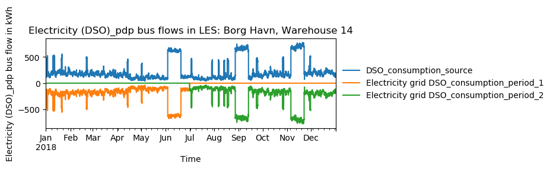

.. This page is generated automatically from parameter_list_eesyplan.csv, parameter_long_description_eesyplan.csv and component_hdrs.csv by _scripts/component_models_csv.py.
   Changes have to be made in the CSV files, not here.

.. _input_parameters:

================
Input parameters
================

This page describes the input parameters of the components in alphabetical order. Details that only apply to a
single component are given in the description of the component on the page :ref:`component_models`.

.. admonition:: Parameters on this page
   :class: cm-params-box

   :ref:`Absolute heat losses <param-absolute_heat_losses>`, :ref:`Age of the installed asset <param-age_existing>`, :ref:`Charging rate (C-Rate) <param-charging_c_rate>`, :ref:`Coefficient of performance <param-coefficient_of_performance>`, :ref:`Conversion efficiency <param-conversion_efficiency>`, :ref:`Discharge rate <param-discharging_c_rate>`, :ref:`Electrical efficiency <param-chp_electrical_efficiency>`, :ref:`Energy price <param-energy_price>`, :ref:`Feed-in tariff <param-feedin_tariff>`, :ref:`Installed capacity <param-installed_capacity>`, :ref:`Lifetime of the asset <param-lifetime_asset>`, :ref:`Maximum capacity <param-maximum_capacity>`, :ref:`Maximum feed-in power <param-maximum_feed_in_power>`, :ref:`Maximum state of charge <param-max_state_of_charge>`, :ref:`Minimum state of charge <param-min_state_of_charge>`, :ref:`Name <param-asset_name>`, :ref:`Peak demand pricing <param-peak_demand_pricing>`, :ref:`Recovered heat efficiency <param-recovered_heat_efficiency>`, :ref:`Relative heat losses <param-relative_heat_losses>`, :ref:`Return pipe <param-return_pipe>`, :ref:`Specific investment costs <param-specific_investment_costs>`, :ref:`Specific yearly operational costs <param-specific_operation_costs>`, :ref:`Storage efficiency <param-charging_efficiency>`, :ref:`Thermal efficiency <param-chp_thermal_efficiency>`, :ref:`Timeseries (kW) <param-timeseries>`, :ref:`Variable operational costs <param-variable_costs>`

.. _param-absolute_heat_losses:

********************
Absolute heat losses
********************

The absolute heat losses describe the heat lost to the surroundings in each timestep, independent of the amount of transported heat, as the pipes are kept at operating temperature. They are given in kW and depend on the pipe length, diameter and insulation as well as on the temperature difference between the heat carrier and the ground. Whether a constant value or a timeseries can be entered depends on the component, please see the description of the respective component.

**Used by:** :ref:`HeatingNetwork <heatingnetwork>`, :ref:`HeatingPipe <heatingpipe>`

.. _param-age_existing:

**************************
Age of the installed asset
**************************

The age of the installed asset is the number of years it has already been in operation. Together with the lifetime, it determines the remaining lifetime of the existing capacity: if the project duration is longer than the remaining lifetime, the replacement costs of the asset are taken into account, e.g. a heat pump with a lifetime of 20 years and an age of 15 years has to be replaced after 5 years of a 20-year project. For new assets, the age is 0. The value only affects the installed capacity, not the newly optimized capacity.

**Used by:** :ref:`Electrolyzer <electrolyzer>`, :ref:`ChpVariableRatio <chpvariableratio>`, :ref:`ChpFixedRatio <chpfixedratio>`, :ref:`FuelCell <fuelcell>`, :ref:`FuelGenerator <fuelgenerator>`, :ref:`ElectricalTransformator <electricaltransformator>`, :ref:`Boiler <boiler>`, :ref:`HeatPump <heatpump>`, :ref:`PvPlant <pvplant>`, :ref:`WindTurbine <windturbine>`, :ref:`SolarThermalPlant <solarthermalplant>`, :ref:`GeothermalPlant <geothermalplant>`, :ref:`BiogasPlant <biogasplant>`, :ref:`FuelStorage <fuelstorage>`, :ref:`ThermalStorage <thermalstorage>`, :ref:`HydrogenStorage <hydrogenstorage>`, :ref:`ElectricalStorage <electricalstorage>`

.. _crate-label:
.. _param-charging_c_rate:

**********************
Charging rate (C-Rate)
**********************

The charging C-rate defines the maximum power at which the storage can be charged, relative to its nominal capacity; it is the reciprocal of the time needed to charge the storage completely. A C-rate of 1 means that the storage can be fully charged within one hour, 0,5 within two hours and 0,25 within four hours. The maximum charging power results from the nominal capacity multiplied by the C-rate, e.g. 0,5 × 100 kWh = 50 kW.

**Used by:** :ref:`ElectricalStorage <electricalstorage>`

.. _param-coefficient_of_performance:

**************************
Coefficient of performance
**************************

This parameter is only used by the HeatPump component, please see the description of the component.

**Used by:** :ref:`HeatPump <heatpump>`

.. _efficiency-label:
.. _param-conversion_efficiency:

*********************
Conversion efficiency
*********************

The conversion efficiency describes how much of the energy fed into the component is available as useful output, e.g. heat from a boiler, electricity from a generator or fuel cell, or hydrogen from an electrolyzer. With an efficiency of 0,9, 100 kWh of output require about 111 kWh of input (100 / 0,9), while the rest is not converted into the useful output, mostly as heat. The efficiency is constant in the model and depends neither on the load nor on the age of the component. For fuels and hydrogen, it should refer to the same heating value as the energy prices, usually the lower heating value.

**Used by:** :ref:`Electrolyzer <electrolyzer>`, :ref:`FuelCell <fuelcell>`, :ref:`FuelGenerator <fuelgenerator>`, :ref:`ElectricalTransformator <electricaltransformator>`, :ref:`Boiler <boiler>`

.. _param-discharging_c_rate:

**************
Discharge rate
**************

The discharging C-rate defines the maximum power at which the storage can be discharged, relative to its nominal capacity; it is the reciprocal of the time needed to discharge the storage completely, e.g. a value of 1 for a storage with 100 kWh allows a discharging power of 100 kW, so the storage can be emptied within one hour. It is used if charging and discharging power differ, e.g. for a tank that is filled slowly but emptied quickly.

**Used by:** :ref:`ElectricalStorage <electricalstorage>`

.. _param-chp_electrical_efficiency:

*********************
Electrical efficiency
*********************

The electrical efficiency at maximal heat extraction describes how much of the fuel energy a CHP converts into electricity when the heat is fully used, e.g. 0,35 means that 1 kWh of fuel results in 0,35 kWh of electricity. Together with the thermal efficiency, it describes the operating point with the highest heat output. How the value is used depends on the type of CHP: for a CHP with a fixed ratio, it applies in every hour of operation, while a CHP with a variable ratio can also be operated with less heat extraction and a higher electrical efficiency. Please see the description of the respective component.

**Used by:** :ref:`ChpFixedRatio <chpfixedratio>`

.. _energyprice-label:
.. _param-energy_price:

************
Energy price
************

The energy price is the price per kWh of the energy carrier sourced from an energy provider. It should include all cost components that depend on the consumed energy, such as procurement, energy-related grid fees, taxes and levies, as far as they are relevant for the project, while capacity-related grid fees are entered separately as peak demand pricing. Whether a constant price or a timeseries with time-dependent prices can be entered depends on the provider, please see the description of the respective energy provider.

**Used by:** :ref:`DsoHydrogen <dsohydrogen>`, :ref:`DsoHeat <dsoheat>`, :ref:`DsoFuel <dsofuel>`, :ref:`DsoElectricity <dsoelectricity>`

.. _feedintariff-label:
.. _param-feedin_tariff:

**************
Feed-in tariff
**************

The feed-in tariff is the price received per kWh fed into the grid of an energy provider, e.g. for surplus electricity from a PV plant. It must not be higher than the energy price, otherwise the tool reports an error, as the optimization could buy and sell energy at the same time without limit. The amount of feed-in can be limited with the maximum feed-in power. Whether a constant value or a timeseries can be entered depends on the provider, please see the description of the respective energy provider.

**Used by:** :ref:`DsoHydrogen <dsohydrogen>`, :ref:`DsoHeat <dsoheat>`, :ref:`DsoFuel <dsofuel>`, :ref:`DsoElectricity <dsoelectricity>`

.. _installedcap-label:
.. _param-installed_capacity:

******************
Installed capacity
******************

The installed capacity is the capacity of the asset that already exists at the project site. It is always part of the energy system and causes no new investment costs, but its fixed operation and maintenance costs are taken into account, and if the project lasts longer than the remaining lifetime of the asset (lifetime minus age), the replacement costs are considered as well. When the capacity is optimized, the optimization can add further capacity on top of the installed capacity up to the maximum capacity. The capacity always refers to the main output of the component, e.g. the heat output of a boiler or heat pump, the electrical output of a CHP or generator, the peak power of a PV system or the storable energy of a storage.

**Used by:** :ref:`Electrolyzer <electrolyzer>`, :ref:`ChpVariableRatio <chpvariableratio>`, :ref:`ChpFixedRatio <chpfixedratio>`, :ref:`FuelCell <fuelcell>`, :ref:`FuelGenerator <fuelgenerator>`, :ref:`ElectricalTransformator <electricaltransformator>`, :ref:`Boiler <boiler>`, :ref:`HeatPump <heatpump>`, :ref:`PvPlant <pvplant>`, :ref:`WindTurbine <windturbine>`, :ref:`SolarThermalPlant <solarthermalplant>`, :ref:`GeothermalPlant <geothermalplant>`, :ref:`BiogasPlant <biogasplant>`, :ref:`FuelStorage <fuelstorage>`, :ref:`ThermalStorage <thermalstorage>`, :ref:`HydrogenStorage <hydrogenstorage>`, :ref:`ElectricalStorage <electricalstorage>`

.. _lifetime-label:
.. _param-lifetime_asset:

*********************
Lifetime of the asset
*********************

The lifetime is the number of operational years of the asset until it has to be replaced. If the lifetime is shorter than the project duration, the asset is replaced during the project and the replacement investment is included in the costs; if it is longer, the remaining value at the end of the project is credited as residual value. The open-plan-tool does not degrade the efficiencies of assets over their lifetime; for batteries, capacity losses due to aging can only be approximated by shortening the lifetime.

**Used by:** :ref:`Electrolyzer <electrolyzer>`, :ref:`ChpVariableRatio <chpvariableratio>`, :ref:`ChpFixedRatio <chpfixedratio>`, :ref:`FuelCell <fuelcell>`, :ref:`FuelGenerator <fuelgenerator>`, :ref:`ElectricalTransformator <electricaltransformator>`, :ref:`Boiler <boiler>`, :ref:`HeatPump <heatpump>`, :ref:`PvPlant <pvplant>`, :ref:`WindTurbine <windturbine>`, :ref:`SolarThermalPlant <solarthermalplant>`, :ref:`GeothermalPlant <geothermalplant>`, :ref:`BiogasPlant <biogasplant>`, :ref:`FuelStorage <fuelstorage>`, :ref:`ThermalStorage <thermalstorage>`, :ref:`HydrogenStorage <hydrogenstorage>`, :ref:`ElectricalStorage <electricalstorage>`

.. _maxcap-label:
.. _param-maximum_capacity:

****************
Maximum capacity
****************

The maximum capacity limits the total capacity of the asset that can be installed at the project site, including the already installed and the additional capacity. It represents physical or regulatory limits, such as the available roof or land area for PV, the space in a boiler room or a permitted connection power. It only has an effect when the capacity is optimized; if no value is given, the optimization may install as much capacity as is economically optimal. The maximum capacity should not be lower than the installed capacity.

**Used by:** :ref:`Electrolyzer <electrolyzer>`, :ref:`ChpVariableRatio <chpvariableratio>`, :ref:`ChpFixedRatio <chpfixedratio>`, :ref:`FuelCell <fuelcell>`, :ref:`FuelGenerator <fuelgenerator>`, :ref:`ElectricalTransformator <electricaltransformator>`, :ref:`Boiler <boiler>`, :ref:`HeatPump <heatpump>`, :ref:`PvPlant <pvplant>`, :ref:`WindTurbine <windturbine>`, :ref:`SolarThermalPlant <solarthermalplant>`, :ref:`GeothermalPlant <geothermalplant>`, :ref:`BiogasPlant <biogasplant>`, :ref:`FuelStorage <fuelstorage>`, :ref:`ThermalStorage <thermalstorage>`, :ref:`HydrogenStorage <hydrogenstorage>`, :ref:`ElectricalStorage <electricalstorage>`, :ref:`DsoHydrogen <dsohydrogen>`, :ref:`DsoHeat <dsoheat>`, :ref:`DsoFuel <dsofuel>`, :ref:`DsoElectricity <dsoelectricity>`

.. _feedincap-label:
.. _param-maximum_feed_in_power:

*********************
Maximum feed-in power
*********************

The maximum feed-in power limits the power that can be fed into the network of the provider in each timestep. It can represent the capacity of the connection, e.g. of a grid connection point or heat transfer station, a limit set by the network operator or regulatory requirements. If the limit is reached, surplus energy has to be stored, used otherwise or dumped as excess energy. If no value is given, the feed-in is unlimited; a value of 0 prevents any feed-in.

**Used by:** :ref:`DsoElectricity <dsoelectricity>`

.. _socmax-label:
.. _param-max_state_of_charge:

***********************
Maximum state of charge
***********************

The maximum state of charge is the highest permissible level of charge of the storage, given as a factor of its nominal capacity; a value of 1 means that the storage can be filled completely. Lower values reduce the usable capacity and are used, for example, to protect batteries from accelerated aging at high charge levels or to keep a safety margin in tanks. The usable capacity results from the difference between the maximum and the minimum state of charge multiplied by the nominal capacity, e.g. (0,9 − 0,1) × 100 kWh = 80 kWh. In the model, the state of charge at the first and the last timestep of the simulation is equal, so the storage cannot simply be emptied over the simulated period.

**Used by:** :ref:`FuelStorage <fuelstorage>`, :ref:`HydrogenStorage <hydrogenstorage>`, :ref:`ElectricalStorage <electricalstorage>`

.. _socmin-label:
.. _param-min_state_of_charge:

***********************
Minimum state of charge
***********************

The minimum state of charge is the lowest permissible level of charge of the storage, given as a factor of its nominal capacity; a value of 0 means that the storage can be emptied completely. Higher values are used, for example, to protect batteries against deep discharge or to keep a reserve, such as fuel for emergency operation. The minimum state of charge must be lower than the maximum state of charge; if both values are equal, the storage can neither be charged nor discharged and is therefore not usable.

**Used by:** :ref:`FuelStorage <fuelstorage>`, :ref:`HydrogenStorage <hydrogenstorage>`, :ref:`ElectricalStorage <electricalstorage>`

.. _param-asset_name:

****
Name
****

The name identifies the component in the energy system and in the results. It has to be unique within a scenario, so that every component can be clearly assigned, e.g. “PV roof south” or “Heat pump building A”. A meaningful name makes the results easier to read, especially if several components of the same type are used.

**Used by:** :ref:`Electrolyzer <electrolyzer>`, :ref:`ChpVariableRatio <chpvariableratio>`, :ref:`ChpFixedRatio <chpfixedratio>`, :ref:`FuelCell <fuelcell>`, :ref:`FuelGenerator <fuelgenerator>`, :ref:`ElectricalTransformator <electricaltransformator>`, :ref:`Boiler <boiler>`, :ref:`HeatPump <heatpump>`, :ref:`PvPlant <pvplant>`, :ref:`WindTurbine <windturbine>`, :ref:`SolarThermalPlant <solarthermalplant>`, :ref:`GeothermalPlant <geothermalplant>`, :ref:`BiogasPlant <biogasplant>`, :ref:`FuelStorage <fuelstorage>`, :ref:`ThermalStorage <thermalstorage>`, :ref:`HydrogenStorage <hydrogenstorage>`, :ref:`ElectricalStorage <electricalstorage>`, :ref:`HeatDemand <heatdemand>`, :ref:`ElectricityDemand <electricitydemand>`, :ref:`H2Demand <h2demand>`, :ref:`FuelDemand <fueldemand>`, :ref:`HeatingNetwork <heatingnetwork>`, :ref:`CarrierBus <carrierbus>`, :ref:`HeatingPipe <heatingpipe>`, :ref:`DsoHydrogen <dsohydrogen>`, :ref:`DsoHeat <dsoheat>`, :ref:`DsoFuel <dsofuel>`, :ref:`DsoElectricity <dsoelectricity>`

.. _peakdemand-label:
.. _param-peak_demand_pricing:

*******************
Peak demand pricing
*******************

Peak demand pricing is a fee based on the highest power drawn from the provider within a pricing period. With such a tariff, the consumer pays not only for the aggregated energy consumption but also for the maximum load, e.g. 100 €/kW and a peak load of 50 kW result in 5.000 € for that period. In the model, the peak load of each pricing period is determined and charged with this price, which gives the optimization an incentive to reduce load peaks, e.g. with storages or flexible operation. A value of 0 deactivates peak demand pricing.

**Used by:** :ref:`DsoElectricity <dsoelectricity>`

.. _param-recovered_heat_efficiency:

*************************
Recovered heat efficiency
*************************

This parameter is only used by the Electrolyzer component, please see the description of the component.

**Used by:** :ref:`Electrolyzer <electrolyzer>`

.. _param-relative_heat_losses:

********************
Relative heat losses
********************

This parameter is only used by the HeatingPipe component, please see the description of the component.

**Used by:** :ref:`HeatingPipe <heatingpipe>`

.. _param-return_pipe:

***********
Return pipe
***********

This parameter is only used by the HeatingPipe component, please see the description of the component.

**Used by:** :ref:`HeatingPipe <heatingpipe>`

.. _specificcosts-label:
.. _param-specific_investment_costs:

*************************
Specific investment costs
*************************

The specific investment costs are the costs of the asset per unit of capacity. They are multiplied by the capacity added by the optimization and, together with the lifetime, the project duration and the discount factor, converted into annual costs that include replacement investments and the residual value at the end of the project. The value should include all capacity-related investments, such as equipment, installation and commissioning, while planning costs that do not depend on the capacity are considered separately as fixed project costs in the scenario settings. The value always refers to the same unit as the capacity of the asset, e.g. per kW\_th of heat output for a boiler or per kWh of storage capacity for a storage.

**Used by:** :ref:`Electrolyzer <electrolyzer>`, :ref:`ChpVariableRatio <chpvariableratio>`, :ref:`ChpFixedRatio <chpfixedratio>`, :ref:`FuelCell <fuelcell>`, :ref:`FuelGenerator <fuelgenerator>`, :ref:`ElectricalTransformator <electricaltransformator>`, :ref:`Boiler <boiler>`, :ref:`HeatPump <heatpump>`, :ref:`PvPlant <pvplant>`, :ref:`WindTurbine <windturbine>`, :ref:`SolarThermalPlant <solarthermalplant>`, :ref:`GeothermalPlant <geothermalplant>`, :ref:`BiogasPlant <biogasplant>`, :ref:`FuelStorage <fuelstorage>`, :ref:`ThermalStorage <thermalstorage>`, :ref:`HydrogenStorage <hydrogenstorage>`, :ref:`ElectricalStorage <electricalstorage>`

.. _specificomcosts-label:
.. _param-specific_operation_costs:

*********************************
Specific yearly operational costs
*********************************

The specific operation and maintenance costs are the fixed annual costs per unit of installed capacity, independent of how much the asset is operated. They typically cover maintenance, inspection, insurance and service contracts and are often given as a percentage of the investment costs, e.g. 2 % of 1.000 €/kW result in 20 €/(kW\*a). Costs that depend on the amount of energy produced belong to the variable operational costs, and fuel costs belong to the fuel source.

**Used by:** :ref:`Electrolyzer <electrolyzer>`, :ref:`ChpVariableRatio <chpvariableratio>`, :ref:`ChpFixedRatio <chpfixedratio>`, :ref:`FuelCell <fuelcell>`, :ref:`FuelGenerator <fuelgenerator>`, :ref:`ElectricalTransformator <electricaltransformator>`, :ref:`Boiler <boiler>`, :ref:`HeatPump <heatpump>`, :ref:`PvPlant <pvplant>`, :ref:`WindTurbine <windturbine>`, :ref:`SolarThermalPlant <solarthermalplant>`, :ref:`GeothermalPlant <geothermalplant>`, :ref:`BiogasPlant <biogasplant>`, :ref:`FuelStorage <fuelstorage>`, :ref:`ThermalStorage <thermalstorage>`, :ref:`HydrogenStorage <hydrogenstorage>`, :ref:`ElectricalStorage <electricalstorage>`

.. _param-charging_efficiency:

******************
Storage efficiency
******************

The charging efficiency is the ratio of the energy that is stored to the energy taken from the bus, e.g. 0,95 means that 95 kWh are stored when 100 kWh are charged. In the model, the efficiency is constant and depends neither on the state of charge nor on the charging power. The storage technologies themselves are not modelled in detail, so additional energy needed to operate the storage, e.g. for pumps of a fuel storage or for the compression, cooling or chemical binding of hydrogen, is not included and can be considered separately if relevant.

**Used by:** :ref:`ThermalStorage <thermalstorage>`, :ref:`ElectricalStorage <electricalstorage>`

.. _param-chp_thermal_efficiency:

******************
Thermal efficiency
******************

The thermal efficiency at maximal heat extraction describes how much of the fuel energy a CHP provides as usable heat, e.g. 0,55 means that 1 kWh of fuel results in 0,55 kWh of heat. Together, the electrical and the thermal efficiency cannot exceed 1; the remaining share are losses. How the value is used depends on the type of CHP: for a CHP with a fixed ratio, heat and electricity are always produced in the same ratio, while a CHP with a variable ratio can also reduce the heat extraction in favour of electricity. Please see the description of the respective component.

**Used by:** :ref:`ChpFixedRatio <chpfixedratio>`

.. _param-timeseries:

***************
Timeseries (kW)
***************

A timeseries describes how a value changes over the simulated period, e.g. a heat demand or the generation of a PV plant. It contains one value per timestep, so the number of values has to match the scenario settings, e.g. 8.760 values for one year with hourly timesteps, starting with the start date of the simulation. It can be uploaded as an Excel file with two columns (A: hour or timestamp, B: value) or as a CSV file without header (e.g. 1;12,5). What the values mean depends on the component: demands are given in kW, generation profiles as output per 1 kW of installed capacity between 0 and 1. Please see the description of the respective component.

**Used by:** :ref:`PvPlant <pvplant>`, :ref:`WindTurbine <windturbine>`, :ref:`SolarThermalPlant <solarthermalplant>`, :ref:`GeothermalPlant <geothermalplant>`, :ref:`BiogasPlant <biogasplant>`, :ref:`HeatDemand <heatdemand>`, :ref:`ElectricityDemand <electricitydemand>`, :ref:`H2Demand <h2demand>`, :ref:`FuelDemand <fueldemand>`

.. _dispatchprice-label:
.. _param-variable_costs:

**************************
Variable operational costs
**************************

The variable operational costs are the costs per kWh of energy flowing through or from the asset, such as wear-related maintenance, consumables or operation-dependent fees. In the open-plan-tool, the costs of inputs such as fuel are not assigned to the conversion asset but to the dispatch price of the fuel source. The value influences the dispatch: the lower the variable costs, the more the asset is preferred by the optimization in each timestep.

**Used by:** :ref:`Electrolyzer <electrolyzer>`, :ref:`ChpVariableRatio <chpvariableratio>`, :ref:`ChpFixedRatio <chpfixedratio>`, :ref:`FuelCell <fuelcell>`, :ref:`FuelGenerator <fuelgenerator>`, :ref:`ElectricalTransformator <electricaltransformator>`, :ref:`Boiler <boiler>`, :ref:`HeatPump <heatpump>`, :ref:`PvPlant <pvplant>`, :ref:`WindTurbine <windturbine>`, :ref:`SolarThermalPlant <solarthermalplant>`, :ref:`GeothermalPlant <geothermalplant>`, :ref:`BiogasPlant <biogasplant>`, :ref:`FuelStorage <fuelstorage>`, :ref:`ThermalStorage <thermalstorage>`, :ref:`HydrogenStorage <hydrogenstorage>`, :ref:`ElectricalStorage <electricalstorage>`
